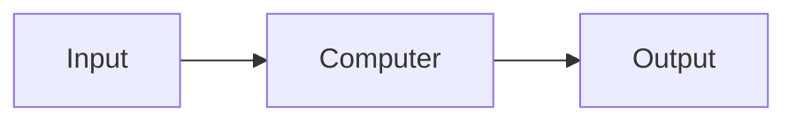
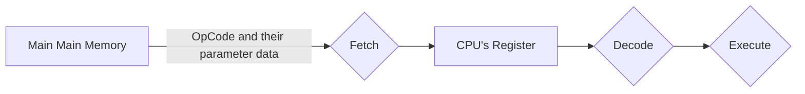
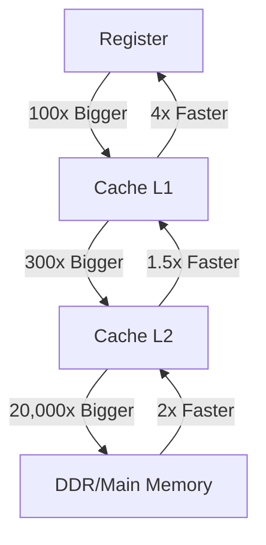

# System Hardware

對於電腦硬體的基礎介紹與定義。

## Definition

所有 Computer 都適用以下定義與大部分配件：

- **CPU**: 全部的計算
- **System Bus**: Information Bus。在 I/O Devices 與 CPU、Main Storage 中來回運送資料，I/O Devices 的優先權較低
- **Main Storage**: DDR (SDRAM、RAM)。當下 Data 與 Code 存在的地方，關機即消失
- **Secondary Storage**: 硬碟。唯一電腦中可永久儲存的地方
- **Tertiary Storage**: Offline 硬碟，像是 USB、Flash Drive、Tape Drive，通常不需馬上存取
- **GPU**: Video Card，圖形計算

:::info 提醒
Main Storage 等同 Main Memory。
:::

電腦大致可以分為以下類型：

- **Mainframe**: 獨立的大型電腦，常見於學校中
- **Server**: 常見於 Data Center，有完全不同等級的處理力
- **End User Devices**: Desktop、Laptop、Table 與 Portable Phone 等

## CPU

Computer's Brain。

- Silicon Chip
- Computer 唯一執行 Code 的地方
- 只執行 Machine Language (OpCode、Instruction)，平常我們寫的 Higher Level Language 會轉譯過來
- 每種 CPU 有自己的 ISA，Instruction Set Architecture，如 ARM、x86-64 等，供他自己閱讀與執行 OpCode
- 每個 CPU 有微量的 Memory，稱為 Registers (Instruction Register)，暫時儲存結果來進行計算
- 只能執行 Basic Command 像是 Move、Add、Subtract、Multiply、Compare、Jump 等，並且執行這些 Command (Instruction) 的能力是物理上被寫在 Silicon Chip 中的
- Operates on a Fetch-Decode-Execute Cycle
- 每個 CPU 有 Cache Memory，提供比 Main Memory 更快的存取速度，但軟體工程師一般無法對此進行操作

| Instruction | OpCode (Numeric Value) |
| ----------- | ---------------------- |
| ADD         | 0x00                   |
| AND         | 0x20                   |
| CMP         | 0x38                   |
| INT         | 0xCD                   |
| JMP         | 0xE9                   |

### Fetch-Decode-Execute Cycle

不斷重複直到完成指令，CPU 每秒可執行數百萬次 Cycle：

## Memory Hierarchy

當 CPU 要執行 Code，Code 必須在 Register 內。為什麼不直接把所有東西都存在 Register 內？這樣就不必在每次計算前傳遞資料了。因為，太貴。所以有個 Memory Hierarchy，越高層越貴但越快，反之亦然：

### RAM

DDR (SDRAM、RAM)。當下 Data 與 Code 存在的地方，關機即消失。

- Random Access Memory
- 組成單位為 Bytes
- 取得每個 Byte 的時間一樣
- 當執行程式，該程式的 Instructions 會全被放入 RAM 中，並且一個接一個以 Fetch-Decode-Execute Cycle 拉進 CPU
- 當關機，資料全部消失

### Secondary Storage

硬碟。唯一電腦中可永久儲存的地方。

#### HDD

Hard Disk Drive。

- Also known as **Spinning Drives**
- Contain multiple magnetic material discs which rotate together at a constant velocity
- Contain read heads which move to different radii on the disk
- Allow the system to access any position via it’s three dimensional polar coordinates
- Accessing first the innermost radius then the outermost radius takes significantly longer than two adjacent radii
- Size is usually measured in **Terabytes**

#### SSD

Solid State Disks。

- Contain a number of chips like USB flash drives
- Data is stored, electrically, in these chips
- All data can be access in the **Same Amount Of Time**
- Due to cost, these drives a smaller than HDDs but perform much faster
