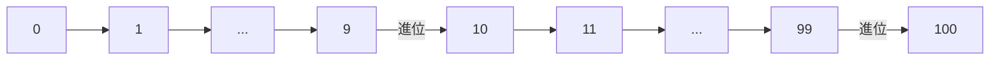
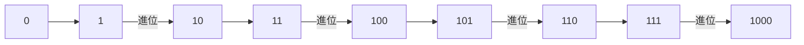
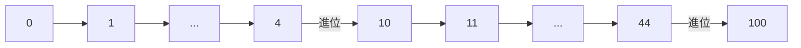
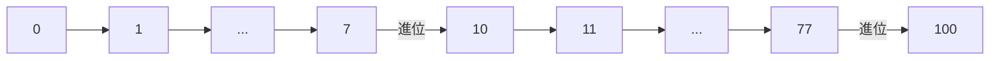
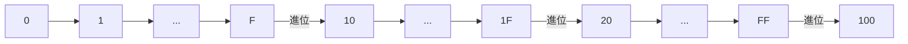

# Number Systems

Positional Number System。全部在電腦中的資料都只有 0 與 1 兩個狀態、以 Binary Numbers 型態表示，無論是以電子或磁的方式儲存。

- **Number**: Represented in binary
- **Image**: Matrix of pixels’ colors. Each color is represented as levels such as RGB
- **Video**: Sequence of images
- **Audio**: Sampled voltage levels. 如果將聲波切得非常細，我們可以用電壓表示他每個波段的高低
- **Text**: Each character is mapped to a number

| Code | Character |
| ---- | --------- |
| 32   | {space}   |
| 33   | !         |
| 34   | "         |

### Number Systems

各種進位系統。

#### Base Ten

又稱 **Decimal Number System**。Digits 有 `0`、`1`、`2`、`3`、`4`、`5`、`6`、`7`、`8`、`9`。每當到 10，則將 10 移到下一位化為 1。因此稱為 10 進位：



:::info 提醒
其他 Number System 與 Base Ten 雷同，到達該進位值後便會到下一位。明顯的點是 10 進制在同一位不會出現 10，5 進制不會出現 5，8 進制不會出現 8。
:::

#### Base Two

又稱 **Binary Base System**。Digits 有 `0`、`1`：



#### Base Five

Digits 有 `0`、`1`、`2`、`3`、`4`：



#### Base Eight

又稱 **Octal Number System**。Digits 有 `0`、`1`、`2`、`3`、`4`、`5`、`6`、`7`：



#### Base Sixteen

又稱 **Hexadecimal Number System**。Digits 有 `0`、`1`、`2`、`3`、`4`、`5`、`6`、`7`、`8`、`9`、`A`、`B`、`C`、`D`、`E`、`F`：



## 進制換算

首先，要表達一個數字所屬的括號，應寫 `(13)₁₀`，而 `(13)₁₀` 在不同進制表達為：

- **Base Eight**: `(15)₈`
- **Base Five**: `(23)₅`
- **Base Two**: `(1101)₂`
- **Base Sixteen**: `(d)₁₆`

### Any to Decimal

- `(375)₁₀`: 5\*10⁰ + 7\*10¹ + 3\*10² = 375
- `(125)₈`: 5\*8⁰ + 2\*8¹ + 1\*8² = 85
- `(1011)₂`: 1\*2⁰ + 1\*2¹ + 0\*2² + 1\*2³ = 11
- `(3B2)₁₆`: 2\*16⁰ + B\*16¹ + 3\*16² = 946

### Decimal to Any

首先以下公式：

```bash
1 + 2 + 4 + 8 + ... + 2ᵏ = 2ᵏ⁺¹-1
```

由此可知，到第 `_` 位的值必為所有數加起來減一。而我們有以下題目：

```bash
(75)₁₀ = (__)₂
```

2⁶ 是 64，2⁵ 之前總和必為 63，因此我們可以直接從第 7 位開始找：

- `0`/2⁷ `1`/2⁶ `0`/2⁵ `0`/2⁴ `1`/2³ `0`/2² `1`/2¹ `1`/2⁰
- 0*2⁷ + 1*2⁶ + 0*2⁵ + 0*2⁴ + 1*2³ + 0*2² + 1*2¹ + 1*2⁰
- 0 + 64 + 0 + 0 + 8 + 0 + 2 + 1
- 75

```bash
(75)₁₀ = (1001011)₂
```

:::info 提醒
2 表二進制，可以換為 8 表八進制或其他進制。
:::

### Binary and Hexadecimal

二進制與十六進制間的換算可以直接用一張表說明：

| Hex Digit | 4 Bit Binary | -   | Hex Digit | 4 Bit Binary |
| --------- | ------------ | --- | --------- | ------------ |
| 0         | 0000         |     | A         | 1010         |
| 1         | 0001         |     | B         | 1011         |
| 2         | 0010         |     | C         | 1100         |
| 3         | 0011         |     | D         | 1101         |
| 4         | 0100         |     | E         | 1110         |
| 5         | 0101         |     | F         | 1111         |
| 6         | 0110         |     |           |              |
| 7         | 0111         |     |           |              |
| 8         | 1000         |     |           |              |
| 9         | 1001         |     |           |              |

如 `(Bb9)₁₆` 可以直接換成 `(0011 1011 1001)₂`。而 `(110 1101 0011)` 可以先在最前方加個 0 作 3 個 4 Bit Binary `(0110 1101 0011)`，然後轉為 `(6D3)₁₆`。

:::info 提醒
之所以二進制和十六進制可以直接對換，是因為十六進制每進一位，剛好都是 `2⁴`、16，也就是二進制進四位，所以 4 Bit Binary 可以換成 Hex Digit。
:::

## 基本運算

記得換算到同進制，並且進位退位時記得該進制即可。

Addition：

```bash
 365₈
+243₈
------
 630
```

Subtraction：

```bash
 536₈
+351₈
------
 165
```

### Sign and Magnitude

Binary 中沒有 Signed Number，也就是 `(-26)₁₀` 不能寫成 `(-001 1010)₂`。因此在 Binary 中有個直觀的寫法，最左邊的 (第八位) 數字為 Sign、不做值，也就是 `(-26)₁₀` 會是：

```bash
1001 1010
```

:::caution 注意
`1` 表示負數。在 Signed Number 表示法中，數值範圍從 0000000 到 1111111，只有七位，而一位元組為八位，這是因為第八位數字要用作 Sign 表示。可以表示的數字範圍是 `(-127)₁₀` 到 `(127)₁₀`。
:::

### Two's Complement

正數的情況，`(26)₁₀` 為 `(0001 1010)₂`。這邊與 Sign and Magnitude 的表示法一樣，但負數就不一樣了。當要表示負數時，它的值為 2⁸ - 正值，也就是：

```bash
 00011010₂ 26
+________₂ -26
----------
100000000₂ 2⁸
```

`________` 為 `(11100110)₂`，與 `(00011010)₂` 相加才會是 2⁸，因此 `(11100110)₂` 表示 -26。

:::caution 注意
與 Sign and Magnitude 相同，第八位 (最左邊) 為 `0` 則為正數。
:::
