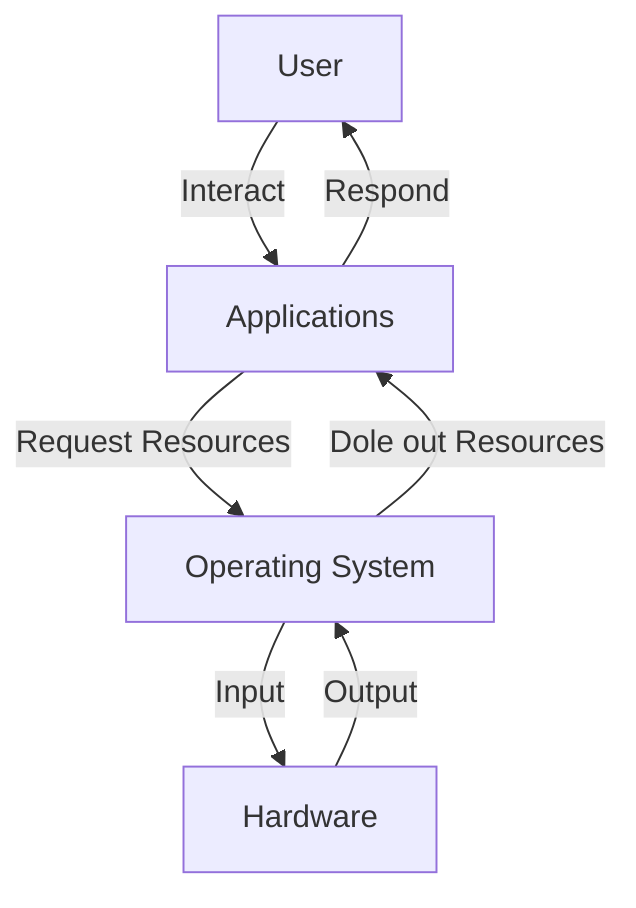
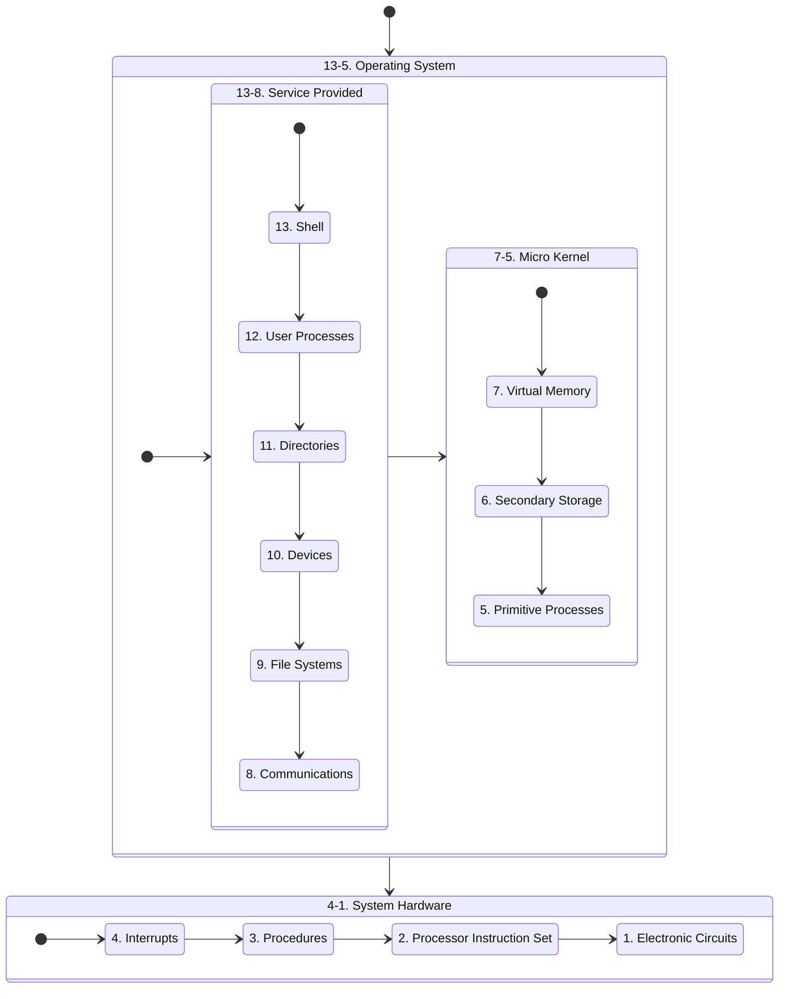
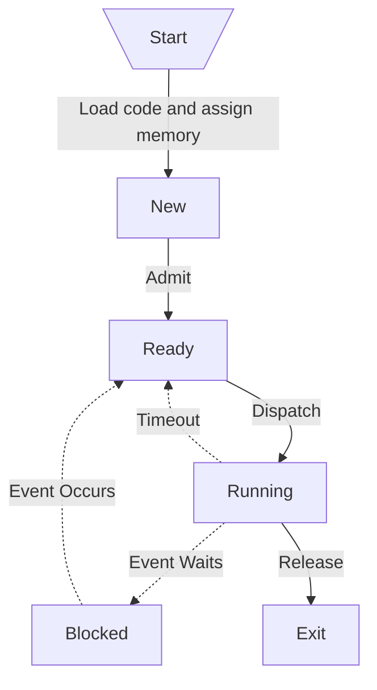
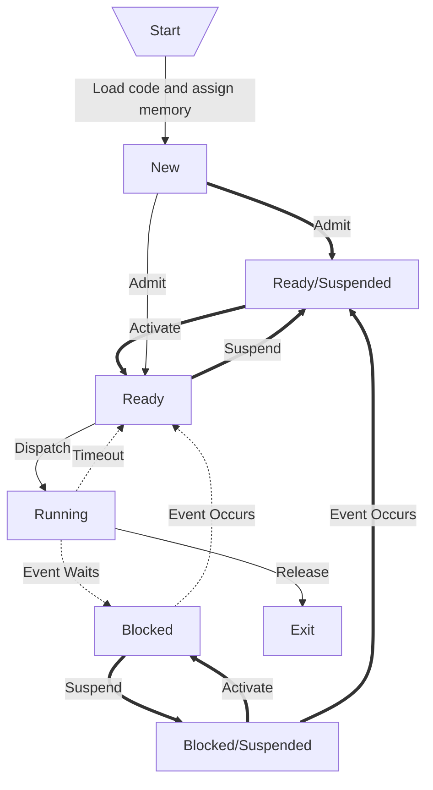

# Operating System

Operating System 與其他階層的關係如下。可以看見，這 4 個 Layer 是 Insulated 絕緣的，User 不可直接與 Operating System 互動，正如 Applications 不可使用 Hardware。：

## Preemption

在遠至 1970 年時，電腦 Mainframe 一次只執行一個程式，又稱 Single-Task。負責控制電腦的人員會將數個 Program 放入一 Batch 中，並按照順序執行。在當中運行哪些程序，使用哪些文件或設備進行輸入或輸出，是使用 JCL，Job Control Language。現今已鮮有使用情境。

而現在的電腦追求 Multi-Task，一次執行多個程式，這點由 Preemption 搶佔式分配資源達到。每每調度資源，OS 會將 CPU 的資源暫存在 Register (Instruction Register、Program Counter、AX、BX 等)，而當恢復時又將資料放回 CPU，因此，程式不會是直接執行到完成，而是在執行間遭遇多個中斷。

又稱 Time Sharing System。

## Levels

電腦可粗分為以下階層。Micro Kernel 是 Operating System 的核心，其中，Primitive Processes 被用作 Scheduling 和 Resource Management。可以說，OS (13-5) 使用 System Hardware (4-1) 來提供 Service Provided (13-8) 內的服務：

### Hardware Abstract Level

HAL。旨在提供一系列指令 給 OS 使用，而因為不同的系統有不同硬體，因此透過這層媒介，若要更改到硬體，只需要更改 HAL 即可、不需要更改整個 OS ( 類似 OOP 中的 ADT )。注意 HAL 屬於軟體、在 OS 內。當 Microsoft 聲明 Windows RT 可支援 ARM CPU 時，表示他們更改了 Windows RT 這個 OS 的 HAL。

:::info 提醒
Device Driver 使用到類似的概念。硬體工程師開發供給 OS 中的 Kernel 使用的一系列指令供使用者下載 (OS 不會裝有所有硬體的指令)，以便當使用到對應硬體時，Kernel 能下達正確指令。然而，這些 Device Driver 可能因為自身錯誤導致整個 OS Crash (即藍螢幕)。Microsoft 為了避免這種狀況，設立了 Windows Hardware Quality Labs，WHQL，所有要用在 Windows 上的 Device Driver 都必須送去軟硬體來取得認證。
:::

## UNIX

除了 Open Source、眾多分支與版本外，最重要的是 UNIX 是一面向同時複數使用者開發的 OS，所有使用者都能管理他們各自的 Task，非常適合在 Server 上使用。

:::info 提醒
Darwin 是 Apple 以 BSD，一種類似 UNIT 的 OS 為基礎開發的 OS。
:::

:::info 提醒
AIX 是 IBM 開發的極度類似 UNIT、卻未使用到任何一行 UNIT Source Code 的 OS。
:::

## Process

首先需要了解以下：

- **CPU**: 處理單元，一個 CPU Core 同時只能執行一個 Process
- **Program**: 執行的程式檔，通常是 Compile 過的 EXE 檔、還未 Load 進記憶體的 Code。具有唯一性

Process 即執行中的 Program，讓 OS 能追蹤執行的狀態與資源，一個 Program 可以同時有很多 Process。Process 間不可互相存取 Memory，但仍然有如 **IPC** 一類互相溝通資料的方法。一個 Process 是指 Thread 們的容器，默認時，Java 是單一 Thread，而 Python 是 Multi-Thread。Process 由以下構成：

- **Program Code**: 又稱 Code Section，即程式碼
- **Process Counter**: 下一個要執行的 Process 的位置
- **Processor Register**: 又稱 Register Set，為小又能快速取用 CPU 資源的記憶體
- **Stack Space**: 儲存暫時性資料
- **Variables**: Dynamically Allocated Variables 和 Non-Thread-Local Global Variables
- **Data Section**: Thread 間的 Shared Data
- **Memory Cache**: 又稱 Heap，執行時產生的動態記憶體空間

### States

Process 有以下 5 種狀態。每個狀態都會佔據至少一段時間。其中，**Ready** 是在等待 Processor 使用，**Running** 是真正執行，**Block** 是暫時不執行、會發生主因爲該 Process 執行過久，而 **Exit** 是等待 Return Value 後即發生：

### Suspension

而在 5 State 之外，還有一 Suspension。當 Suspend 一個 Process 時，該 Process 會完全從 Main Memory 中移除、存到 Secondary Memory 中 (由 Medium-term Scheduling Algorithm 控制)，並且該 Process 不會意識到被 Suspended (回復到 Main Memory 時仍會與被移除時的狀態一致)。其發生，主要因：

- 空出 Main Memory 給其他 Process 使用
- Long-term Delay
- Debugging

:::info 提醒
Suspended 與 Blocked 相似，但差別在於，Blocked 是主動、如等待 I/O。而 Suspended 通常是被動，而且無法自行恢復。
:::

加上 Ready/Suspended 和 Blocked/Suspended，會產生 7 State：

### Process Control Block

又稱 PCB，列出一個 Process 的所有資訊，是 OS 的一個重要元件，主要有：

- **Memory Table**: Paging 和 Segmentation
- **I/O Table**: 列出該 Process 能夠使用的 Device
- **File Table**: 列出該 Process 能夠訪問的 File
- **Stack**: 所有 Active Function Call

而若細分：

| Content       | Description                                                                            |
| ------------- | -------------------------------------------------------------------------------------- |
| PID           | Process Identifier。16 Bits 的 ID，同時代表 OS 中最多只能有 65,535 個 Process          |
| PPID          | Parent Process ID，Parent Process 能夠得知 Child Process 何時結束並且接收 Return Value |
| UID           | 開啟該 Process 的使用者，影響訪問權                                                    |
| Register      | 理論上會一直變動。當被從 Running State 移出時，會儲存當下的值以便恢復                  |
| Stack Pointer | 指向在 Stack 中儲存的區                                                                |
| Scheduling    | 紀錄執行時長、等待時長，以及何時該移出 Running State                                   |
| Linkages      | 紀錄 Pipe Process。Pipe 中 Return Value 會被作為其他 Process 的 Input                  |
| IPC           | Internal Process Communication。紀錄可互相溝通的 Process                               |
| Resources     | 使用的 I/O Devices 和 Files                                                            |
| Memory        | 被分配到的記憶體                                                                       |

### Modes

每個 Process 都有個 Process State Word，PSW，來紀錄為 **User Mode** 或 **Kernel Mode**。User Mode 的 Process 不能直接使用 System Hardware 而且不能隨意取用記憶體，而 Kernel Mode 的 Process 完全無限制。以前經常發生的藍螢幕大部分肇因於所有 Process 都是 Kernel Mode。

對於 Process 而言，User Mode 切為 Kernel Mode 有幾種原因 (相反情況並不影響)：

- **Interrupt**: 硬體的使用，如網路連結、插入 I/O。會呼叫 **ISR**，Interrupt Services Runtime，來暫時性處理
- **Trap**: 當 Process 造成需要 OS 介入的情境
- **Blocking System Call**: 如讀取檔案等需要 OS 層級的呼叫

User Mode 切為 Kernel Mode 需以下步驟。若為 Multiprocessing，則會發生得更為頻繁與複雜：

1. 將當下 Context 存於 PCB
2. 更新 Accounting
3. 將該 Process 的 PCB 移到合適的 Queue (Ready、Blocked)，來指明下一個對該 Process 的動作
4. 將另一個 Process 放入 Running Queue
5. Update memory management
6. 恢復該 Process 的 Context

## Thread

可以稱為輕量級的 Process，一樣有自己的 Stack Space 與 Memory Cache、Program Counter、Processor Register 等。同 Process 間的 Thread 能共享 Variables 和 Data Section、Program Code、OS Resources ( 如開啟檔案等 )，一旦 Thread 讀取到 Data Section，便會將其儲存在自己的 Memory Cache。

為什麼需要 Multithreading？有以下原因：

- **Foreground/Background**: 如 Microsoft Word，將文法檢查、輸入文字、讀取檔案分在不同 Thread
- **Asynchronous/Synchronous Processing**: 當不可為 Asynchronous Thread 時，分成多個 Synchronous Thread 可以避免一個 Blocked 導致全部等待
- **Infrequent Tasks**: 如每 10 分鐘自動儲存檔案
- **Speed Reading**: 在一個 Thread 讀取檔案同時，另一個 Thread 已開始解析讀入的部分
- **Modular Program Structure**: 將龐大的程式分為多個小任務的 Thread

### State

與 Process 的 States 比較，會發現 Thread 只有 **Ready**、**Running** 和 **Blocked** 3 種 State，這是因爲當 Thread 建立起 Thread Control Block、TCB 時，Code 已經 Load 好了、不具有 **New**。而當 Thread 結束時，只需要被標注結束、而不需要向 Process 回傳值 (除非是最後一個 Thread)，因此不需要 **Exit**。

:::info 提醒
**Suspension** 屬於 Process Level。當一個 Process Suspended，所有 Thread 都會停止。
:::

### Concurrency

使用 Thread，最大的好處是 Concurrency，然而，這也是缺點。在 [/Computer/Concurrency](/docs/6@computer/4@concurrency) 中對 Concurrency 有更詳盡的說明。

### Level

分為 User Level Thread 與 Kernel Level Thread，以及 Hybrid Approach。Kernel Level 的好處是 OS 能夠知道哪個 Thread 在運作，然而不能定優先順序或任何設置。而 User Level Thread 的好處是能由開發員自行定義優先順序，然而 User Level Thread 只是模擬，OS 只知道是一個 Process 在運作、卻不知有 Thread 在裡面。

Hybrid Approach 由 Solaris 開發。當一個 User Level Thread 被創造，那麼就創造一個對應的 Kernel Level Process 稱作 Lightweight Process 並將之包覆。可以使用一對一的方式放入重要性高、再將重要性低的以多對一放入 (當其中一個 Thread Blocked，則該 Lightweight Process 中的所有 Thread 都將 Blocked)。

各家廠商實踐不一，簡單可以想成 Kernel Level Thread 就是 Process，而 User Level Thread 就是 Process 內自行創造出的 Thread。而 OS 的確不能直接控制、取得 Thread 的資訊，但有建立 Thread Control Block，應有間接方法可以追蹤。
