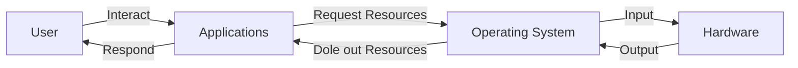
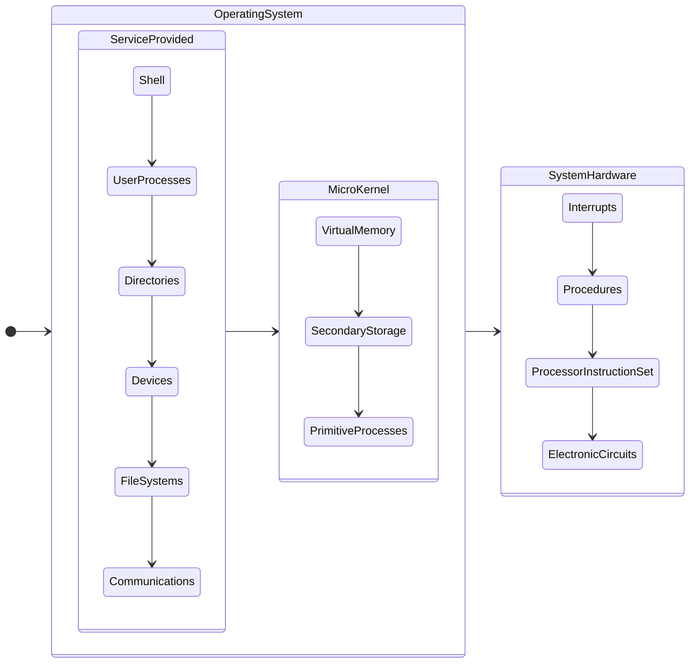

# Operating System

Operating System 與其他階層的關係如下。可以看見，這 4 個 Layer 是 Insulated 絕緣的，User 不可直接與 Operating System 互動，正如 Applications 不可使用 Hardware。：

## Preemption

在遠至 1970 年時，電腦 Mainframe 一次只執行一個程式，又稱 Single-Task。負責控制電腦的人員會將數個 Program 放入一 Batch 中，並按照順序執行。在當中運行哪些程序，使用哪些文件或設備進行輸入或輸出，是使用 JCL，Job Control Language。現今已鮮有使用情境。

而現在的電腦追求 Multi-Task，一次執行多個程式，這點由 Preemption 搶佔式分配資源達到。每每調度資源，OS 會將 CPU 的資源暫存在 Register (Instruction Register、Program Counter、AX、BX 等)，而當恢復時又將資料放回 CPU，因此，程式不會是直接執行到完成，而是在執行間遭遇多個中斷。

又稱 Time Sharing System。

## Process

首先需要了解以下：

- **CPU**: 處理單元，一個 CPU Core 同時只能執行一個 Process
- **Program**: 執行的程式檔，通常是 Compile 過的 EXE 檔、還未 Load 進記憶體的 Code。具有唯一性

Process 即執行中的 Program，一個 Program 可以同時有很多 Process，Process 間不可互相存取 Memory，但仍然有如 **IPC** 一類互相溝通資料的方法。一個 Process 是指 Thread 們的容器，默認時，Java 是單一 Thread，而 Python 是 Multi-Thread。Process 由以下構成：

- **Program Code**: 又稱 Code Section，即程式碼
- **Process Counter**: 下一個要執行的 Process 的位置
- **Processor Register**: 又稱 Register Set，為小又能快速取用 CPU 資源的記憶體
- **Stack Space**: 儲存暫時性資料
- **Variables**: Dynamically Allocated Variables 和 Non-Thread-Local Global Variables
- **Data Section**: Thread 間的 Shared Data
- **Memory Cache**: 又稱 Heap，執行時產生的動態記憶體空間

:::info 提醒
**Thread** 可以稱為輕量級的 Process，一樣有自己的 Stack Space 與 Memory Cache、Program Counter、Processor Register 等。同 Process 間的 Thread 能共享 Variables 和 Data Section、Program Code、OS Resources ( 如開啟檔案等 )，一旦 Thread 讀取到 Data Section，便會將其儲存在自己的 Memory Cache。
:::

## Levels

電腦可以分為以下階層。MicroKernel 是 Operating System 的核心，其中，PrimitiveProcesses 被用作 Scheduling 和 Resource Management。可以說，OS 使用 SystemHardware 來提供 ServiceProvided 內的服務：

### Hardware Abstract Level

HAL。旨在提供一系列指令 給 OS 使用，而因為不同的系統有不同硬體，因此透過這層媒介，若要更改到硬體，只需要更改 HAL 即可、不需要更改整個 OS ( 類似 OOP 中的 ADT )。注意 HAL 屬於軟體、在 OS 內。當 Microsoft 聲明 Windows RT 可支援 ARM CPU 時，表示他們更改了 Windows RT 這個 OS 的 HAL。

:::info 提醒
Device Driver 使用到類似的概念。硬體工程師開發供給 OS 中的 Kernel 使用的一系列指令供使用者下載 (OS 不會裝有所有硬體的指令)，以便當使用到對應硬體時，Kernel 能下達正確指令。然而，這些 Device Driver 可能因為自身錯誤導致整個 OS Crash (即藍螢幕)。Microsoft 為了避免這種狀況，設立了 Windows Hardware Quality Labs，WHQL，所有要用在 Windows 上的 Device Driver 都必須送去軟硬體來取得認證。
:::

## UNIX

除了 Open Source、眾多分支與版本外，最重要的是 UNIX 是一面向同時複數使用者開發的 OS，所有使用者都能管理他們各自的 Task，非常適合在 Server 上使用。

:::info 提醒
Darwin 是 Apple 以 BSD，一種類似 UNIT 的 OS 為基礎開發的 OS。
:::

:::info 提醒
AIX 是 IBM 開發的極度類似 UNIT 卻未使用到任何一行 UNIT Source Code 的 OS。
:::
