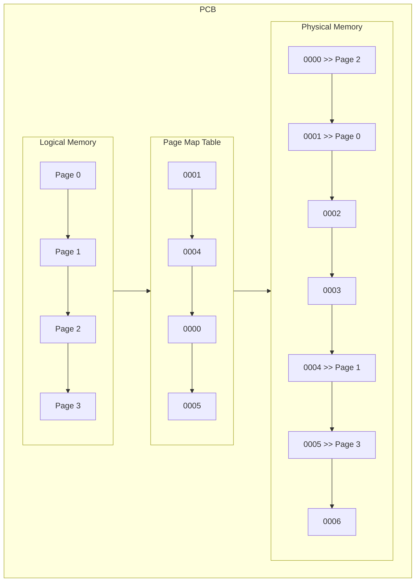

# Memory Management

在一個 Multiprogramming 中，Memory 是永遠不可能足夠的。OS 必須藉由在 Main Memory、Secondary 中移動資料、分配記憶體來達到 Program 的需求。達成 Memory Management 需要以下：

- **Relocation**: Process 應能被 Load 在 Main Memory 的任意位置，且能在該 Process 的 Lifetime 後被移除
- **Protection**: Process 只能訪問自己被分配到的記憶體，而該檢查為 Dynamic (使用當下才分配並檢查)，原因是 OS 無法提前訪問記憶體
- **Sharing**: 有些 Process 可能使用共通的 Code 或者 Data。
- **Logical Organization**: 使用共通的 Modules、Objects、Dynamic Linked Liberties，若多個 Process 使用相同物件，能夠只 Load 一次即可
- **Physical Organization**: 將 Logical Memory Map 到 Physical Memory。此段由 Hardware 負責，最簡單的方法是在每個 Progress 的 Logical Memory 前加上 Offset。Process 只知道分配到的 Logical Memory，因爲 Process 並不知道 Physical Memory 的分配情況

## Partitioning

當系統剛開始，整個 Main Memory 是空的，這時有多種分配給不同的 Process 的策略。要注意，Process 只能被放在跟所需一樣或更大的 Partition 內，且一個 Partition 只能對上一個 Process。

Fixed Partitioning、Dynamic Partitioning 已不再使用，Buddy System 只有極少數個案使用中，Paging 則是當前主流做法。Segmentation 不若 Paging 主流，但仍有一部分佔有率。

### Fixed Partitioning

最簡單、易達成的方法，分為 2 種，但都有顯著的劣處 (**Internal Fragmentation**)：

- **Equal Sized Partitioning**: 將記憶體分為固定數目的相同大小 Partition，然而只要有需求小的 Process，就會造成浪費
- **Unequal Sized Partitioning**: 分成固定數目、有大有小的 Partition，會因為符合所需的 Partition 同時有 2 個以上的 Process 需要而造成等候

### Dynamic Partitioning

在分配 Partition 前詢問 Process 需要的記憶體、並如實切分。然而，會因為中間的 Allocation 分配造成 **External Fragmentation**。原因是，執行完成的 Process 所釋放的空間可能小於新執行的 Process，導致必須將所有 Process 集中在一個連續 Partition (因為記憶體類似一陣列)、當中會耗費諸多 CPU Time。分為：

- **Best Fit**: 精準分配每個 Process 所需要空間，然而最容易造成 External Fragmentation (總有極小的空間閒置)
- **First Fit**: 每次分配時，發現的第一個足夠的空間即進行分配
- **Next Fit**: 由上次分配結束的位置繼續開始。最有效率的做法

### Buddy System

Fix Partitioning 與 Dynamic Partitioning 的綜合，一大特徵是會將 Memory 不斷切分、保持在 2 的倍數 ($2^N$)。舉例而言，若有 2 MB 的記憶體、而我們當下需要分配 100KB，那麼會切分為 1024KB、512KB、256KB、128KB、128KB，並將 100KB 分配於 128KB 的 Partition。

另一大特徵是 **Coalescing**，如 Dynamic Partitioning，Buddy System 會剩餘的空間 (如 128KB 佔用 100KB 後剩餘的 28KB) 組合再一起，行成另外一個可使用的大空間。

:::info 提醒
儘管大部分地方已難見、難以用在 Grand Scale、僅能用在 Micro Scale，Linux 的 **Slab Allocator** 在分配特定 Kernel Process 時仍在使用此方法。Linux 在使用 Coalescing 時會是 **Delayed Coalescing**，也就是組合會發生在一段時間後而不是發現當下。
:::

### Paging

首先要認知的是，Main Memory 是 RAM (Random Access Memory，可以參考 [/Computer/System Hardware#RAM](/docs/6@computer/1@system-hardware#ram))，也就是取得每個 Byte 的時間一樣，因此，不需要將 Process 的 Partition 放在一起。

Process 的 Partition 指的是 Pages。在 Paging 中，整個記憶體被等分為極小的 Partition (如 4KB)，接著，Process 也被分為同樣 Size 的 Partitions (如 4KB)，然後將這些 Process Partitions 分配到到前面記憶體分割好的碎片中，形成 **Pages**。在過程中，OS 會紀錄 Page 對應的 Logical Memory，並且儲存在 **Page Map Table**，PMT 內，接著再將 PMT 儲存到 PCB (可以參考 [/Computer/Operating System#Process Control Block](/docs/6@computer/3@operating-system#process-control-block)) 中，而 PCB 又能夠將 Logical Memory 對應到 Physical Memory，令 Page 能夠間接對應到 Physical Memory：

:::info 提醒
Hardware 對 Page 的支援透過 MMU，Memory Management Unit 達成。MMU 能夠 Query PMT。
:::

:::info 提醒
Logical Memory is also called a **frame**, and it is called a **page** when a partition of a process is put in.
:::

Paging 有以下優勢：

- **No External Fragmentation**: 全部切分為極小尺寸，不會有閒置空間
- **Minium Internal Fragmentation**: Page 尺寸極小，即使有浪費，如 3KB 佔用 4KB，也無需在意
- **Easy Protection**: 從 Page 到 PMT、PMT 到 PCB、PCB 到 Physical Memory 的過程明確，OS 可以輕易找到問題
- **Easy Relocation**: Paging 中 Relocate 的是 Page，而不是整個 Process。尤其在 Paging 中其實不需要 Relocate 了
- **Easy Sharing**: 與 Easy Protection 類似，PMT 和 PCB 提供了詳細的索引，能夠簡單 Share

:::info 提醒
在 Paging 中，Logical Memory 對應到 Physical Memory 的過程，會由於 Pages 永遠是 $2^N$ 而簡化，只需要作 **Bit Shift** 即可取得 Page Number，接著使用 Page Number 在 PMT 中找到 Logical Address，最後 CPU 再對 Logical Address 做 Bit Shift 並加上 Offset 來找到 Physical Memory。

Physical Memory Address 可用以下公式計算而出：

$$
lookupInPMT(logicalAddress/pageSize) \times pageSize + logicalSize \% pageSize
$$

:::

### Segmentation

與 Paging 類似，差別在於 Segmentation 可以用類似 Dynamic Partitioning 的方式將 Segment (對應 Paging 中的 Page) 分配給不同的尺寸。然而，Segment Size 的選項並不是完全動態、而是由 CPU 設計者決定的。

Logical Address 必須用 $Segment Number + Offset$ 來計算。

## Virtual Memory

macOS 與 Linux 中稱為 Swap Space，在記憶體使用 Paging/Segmentation 的情況發生。由於 Process 一次只會處理當下的 Page/Segment，因此，其他部分並不需要放在 Main Memory 中。Virtual Memory 會將不需要的部分 Copy、放在 Secondary Memory 中，當有需要時才取得一份到 Main Memory，並在結束後即移除。這使使用了 Virtual Memory 的系統有更多的記憶體空間能使用 (暫時不被需要的部分都被移出)，進而有更多 Process 能被執行、使效能提高。

Copy 的動作涉及 **Copy-on-Write**，COW，也與 Page 有關。首先，Page 是可分享的，如 Chrome 開啟 5 個分頁、產生 5 個 Process，那他們之間的 Page 中的 **Code Page** (在 PMT 中) 的索引會指向同一個 (OS 能辨認是否執行的 Code 相同)。而如果有多個呼叫者同時要求相同資源 (**Data Page**，如記憶體或磁碟上的資料儲存)，則他們會共同取得相同的 Reference 指向相同的資源，並且該 Page 所屬的 PMT 會增加一 Read Only 屬性、將該 Page 設為 Read Only。直到某個呼叫者試圖修改資源的內容時，系統才會真正複製一份專用副本給該呼叫者、將該副本取消設置 Read Only，而其他呼叫者所指向的 Data Page 仍然保持不變。

Virtual Memory 有以下組成：

- **Resident Set**: Process 中當下在 Main Memory 的部分
- **Working Set**: Process 使用中的部分，而真正要使 Process 能 Run Working Set 的部分，必須先移到 Resident Set 中

### Page Map Table

PMT 中儲存有 Virtual Memory 所需的資訊：

- **Present Bit**: 表示是否該 Page/Segment 在 Main Memory 中
- **Modify Bit**: 表示在 Secondary Memory 中的副本是否與 Main Memory 中的一致，藉此保證副本的一致性
- **Page Fault**: 若 MMU 發現一個 Process 想要執行的部分並不在 Resident Set 中，會產生 Page Fault，如果是有效的，那麼會嘗試將該部分放入 Resident Set，反之，OS 會介入並強制關閉相關 Process。Page Fault 是 **常見** 的

### Lookup Problem

MMU 在 Paging/Segmentation 的情況下，需要執行 2 次的 Memory Lookup (PMT Query 與 Logical Memory to Physical Memory)，使 $\mathcal{O}(1)$ 的執行時間直接變成 2 倍，因此，CPU 使用了 **Translation Look-Aside Buffer**，TLB，一種 Content Addressable Memory，儲存了最近的 PMT **Cache**，即 Virtual Page Number，VPN，與相應的 Physical Page Number，PPN 的對應表。

### Replacement Policy

當記憶體用完時，OS 會需要移除一些 Page，稱為 **Stealing**。有以下幾種 Algorithm：

- **Optimal**: 又稱 Crystal Ball。Steal 不被執行的時長最長者。難以實用，需要額外紀錄資訊
- **LRU**: Least Recent Use。Steal 最近最少被使用 (Access) 者。難以實用，需要額外紀錄資訊
- **FIFO**: Steal 最先進入者，然而效能表現差，極可能產生 Page Fault。能簡單實用
- **Clock**: 能簡單實用，但需要在 PMT 中新增 Use Bit 來表示是否一個部分最近有被使用 (在 TLB 中者即為 1)。高頻率重複檢查 Process Partition、如一時鐘，若為 1 者，初次被指時設為 0，而為 0 者，被指到時即 Steal 該部分，並且在下次放入 TLB 時設為 1

### Resident Set Management

在應用 Resident Set 時，有 2 個主要問題：

- **Memory**: How much main memory does each process deserve? Smaller allocation means **More Processes**, and larger allocation means **Less Page Fault**.
- **When and Which**: When it is time to steal, and which process do we steal from? Process experiences **Page Faulting will lose page**, and it is **global** since any process can lose page.

### Page Fault

If a process fits entirely in main memory, it will **not** generate any page fault. It a process only has 1 page, it will generate the **maximum** number of page fault.

There is a non-linear progression between the upper bound and lower bound, which means we can find a point that the memory allocated to the process can generate an **appropriate** number of page fault, causing not much page faults and is enough to indicate whether the memory (frame) allocated to the process is too much.

> 圖片來源：[UIC](https://www.cs.uic.edu/~jbell/CourseNotes/OperatingSystems/9_VirtualMemory.html)

:::caution 注意
Too many page faults will cause CPU to be busy (**Threshing**) for:

1. Process doesn't have enough frame, causing page faults
2. Page Replacement happens
3. Frames become not enough again, another Page Replacement is required (because of 2 and 3)
4. CPU performance is low because it is **busy at swap in/out memory**

:::

#### Page Fault Frequency

PFF Algorithm is a way to determine whether it is the time to add or remove frames from a process. It examines between the time between the last page fault and the current one, if it is **less** than the preset F value, then **add** a frame. If it is **greater** than the preset F value, **discard unused page** and **reset used page** with 0 bit, then load up the pages. Upper bound and lower bound is the suitable value for the preset F value.

:::info 提醒
Discard unused page and reset used page with 0 bit, then load up the pages. The whole procedure is called **Page Replacement**.
:::

The downside for PFF is that when the algorithm is shifting pages to a completed area (locality), it has to copy all the value from the old pages to the new pages. If the old pages **never encounter a page fault**, then they will **never be unloaded**, so the used memory will be **double** (old and new).

#### Variable Interval Sampled Working Set

VSWS Algorithm is designed to optimize PFF. It uses M and Q instead only F. M is the minium required number for a page replacement, if the number of happened page faults is lower than M, we only add a new frame. Q is the number of page faults since the last time a page replacement happened, if we are above M but not more than Q, we also only add a new frame. Only the page faults happens above M and Q will result in a page replacement.

It has another parameter, L, a duration forces the OS to do a page replacement, no matter how many page fault we have had. **L solves PFF's downside**

### Load Control

We can determine whether we are going to **swap an entire process** (Page Replacement) by looking at its number of page faults. If we choose to swap a process, we can get all its memory but we have to do page replacement to all of its memory. While page replacement is still doable for a portion of a process, Load Control can do it in a grander scale.

Here is the priority:

1. **Lowest Priority**: No explanation so far
2. **Faulting Process**: Great chance because the process would have no working set
3. **Last Process Activated**: Least likely to have working set
4. **Smallest Resident Set**: Require the least effort for page replacement
5. **Largest Process**: Can get lots of memory
6. **Largest Remaining Execution Window**: Has the longest processing time. No one cares whether it is intervened. A reasonable solution for Medium-term Scheduling Algorithm

## UNIX Fork

Fork is a command to create a exact copy (in **NEW** state) a current process (in **RUNNING** state), which returns two values:

1. 0 if the process is a child process (new process), vice versa
2. The process identifier of the child process if it is a parent process.

The command is useful when we want a new different process with the same code. (example: Chrome new tab).

After calling fork, OS will create a new PCB (Reference: [/Computer/Operating System#Process Control Block](/docs/6@computer/3@operating-system#process-control-block)) for the new process, which means the new process will have its own Program Counter, File descriptors, CPU registers, and the program text of the parent process. The OS will also create a new PMT, [Page Map Table](/docs/6@computer/6@memory-management#page-map-table), for the child process (new process) with the copied data from the original program. However, there is no need to really copy the data until something changed (Modified), and only the changed page will be copied, this can be called [Copy-on-Write](/docs/6@computer/6@memory-management#virtual-memory).

After the creation, the parent and child process both will be in **READY** state, and the child process will have higher priority than the parent child.
