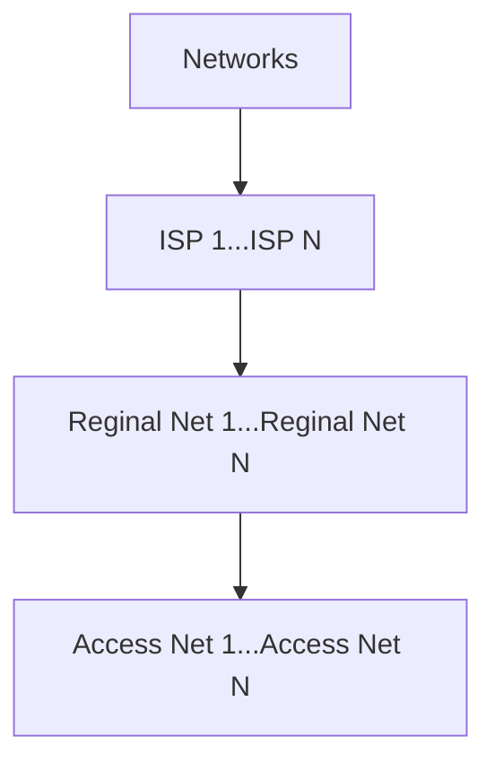
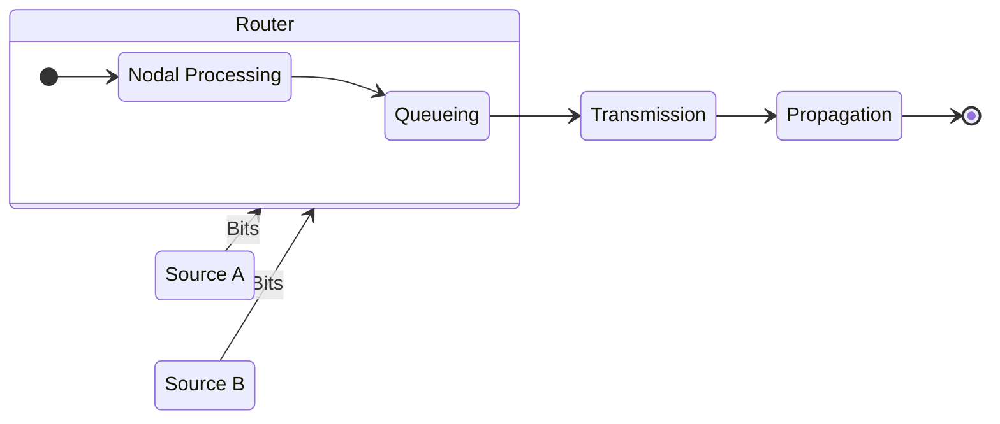
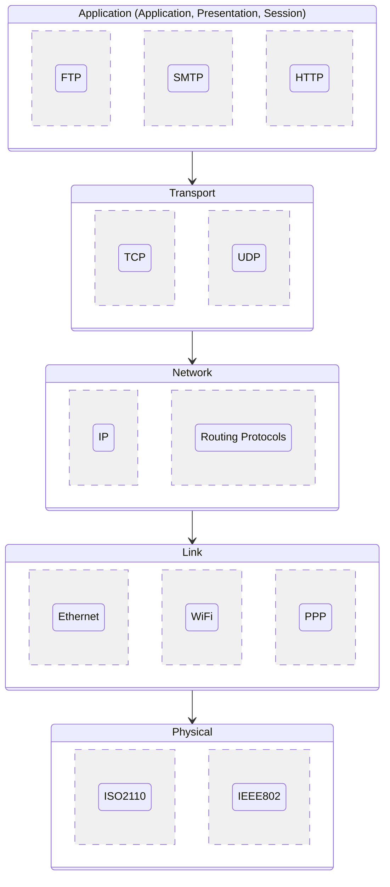
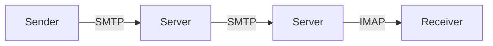
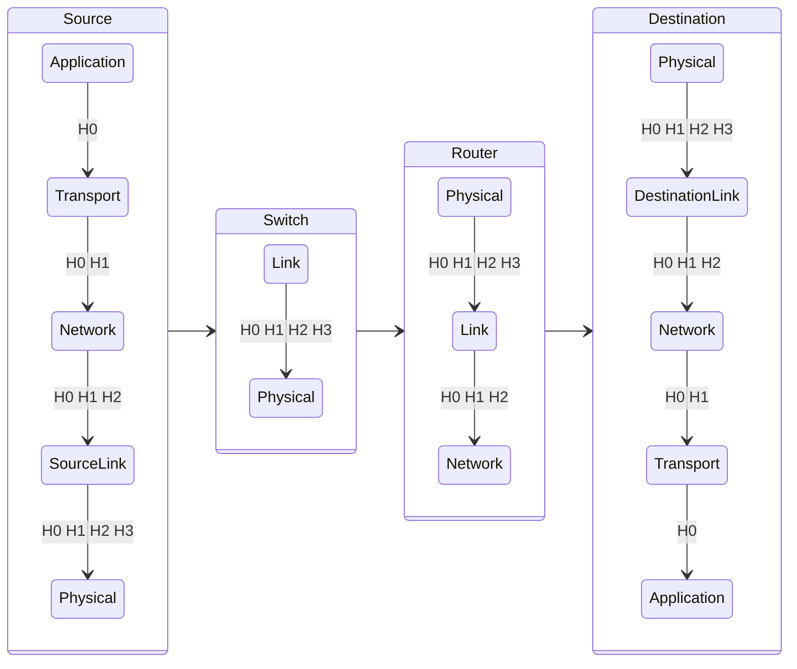

# Internet

一種 Network 的應用實踐，而 **WWW**，World Wide Web 透過 Internet 連結與存取。Internet Structure 由 **Host**、[Connection Link](/docs/6@computer/7@networking#connection-link) 及 **Packet Switch** 組成並
跟隨由如 IETF，Internet Engineering Task Force 等組織制定的標準 (RHC，Request For Comment)：

- **Host**: 執行 Network Application 的 End System，可以是 Client 或 Server
- **Packet Switch**: Router 與 Switch，負責轉送 Packet。Internet

Internet 的主要目的，是作為一個 Infrastructure 提供如 Web、VoIP、Game 之類的 Service。也作為 Application 間的 Programming Interface，來讓 Application 間可以互相 Send/Receive Information。

## Network Edge

Internet 的一個封閉部分，如 Home Network、Residential Access Net 等，由以下組成：

- **Host**: Client 或 Server
- **Server**: 通常在 Data Center
- **Physical Media**: Wired or Wireless
- **Network Core**: Interconnected Router or Network of Networks

## ISP

Internet Service Provider，網絡服務供應商，即指提供網際網路存取服務如 DSL 的公司，如 Residential、University、Company。Network 連向 ISP，而 ISP 間互相以 **IXP**、**Peering Link** 連接。注意的是，Access Net 的活躍通常與 Commercial 或 National Policy 有關：

:::caution 注意
Access Net 即為最底層的 Network，而 Reginal Net 同時可以視作下游 ISP。Google、Microsoft、Sprint、Facebook 等在為上游 ISP 的同時，也是 Content Provider Network，儘管定義上是 Internet 中其中一個 Network，但他們提供了靠近使用者端的服務，使他們遍及整個 Networks。
:::

## Packet

封包。透過 Internet 傳送的資料單位 (Chunk of data)，由 Application Layer Message 拆分而來，內有目的地 Address，並且每經過一層就會加上 Header，這樣在 Data 到達目的時才知道從哪來、要去哪、什麼時候送的。

## Delay

傳輸 Packet 時，會在各個階段遇到各種不同的 Delay。

### Nodal Processing

Nodal Processing Delay，發生在檢查 Router 內的 Bit Error 時、Queueing 之前，通常小於 Millisecond。可以想成在一個隊伍在進去大會會場前、自行先報數確認人數順序的情境。

### Transmission

Transmission Delay，傳送封包時，採用 **Store-and-Forward** 政策。當封包開始從 Source 傳送到 Router 時，會是以 Bit 為單位，只有當 Router 端有 Source 來的 Packet 的全部 Bit 時，才會將 Packet 再次以 Bit 為單位傳送到下個目的地。舉例而言，要傳送的封包 L 有 7.5Mbits，而傳送速率 R 為 1.5Mbps，那麼此封包需要 5 秒來到達 Router。而通常而言，我們假設 End-to-End Delay (Transmission Delay) 為 2L/R (假設沒有 Propagation Delay)。

:::info 提醒
Each packet transmitted at full link capacity.
:::

### Queueing

Queueing Delay，當等待被傳送的 Packet Bit 超過傳送速度，則會發生 Queueing，而若 Queue 內的 Bit 超過 Router 的 Memory Buffer，就會發生 **Queueing Loss**，導致在 Queue 後端已達到的封包在還未被傳送時即消失。設 L 為欲傳送的封包、R 為傳送速度 Bandwidth、A 為 Average Packet Arrival Rate，他們與 Average Queueing Delay 間的關係為：

- $LA/R \sim 0$: Small
- $LA/R \sim 1$: Large
- $LR/R >1$: More work arriving than serving, the delay is **infinite**

### Propagation

Propagation Delay，假設 D 為 Physical Link 的長度，而 S 為介質的 Propagation Speed (Approximate $2x108m/sec$)，那麼 Propagation Delay 為 D/S。

:::info 提醒
**Throughput**，吞吐量，即 Bits/Time Unit，可以用來在較長的時間中解釋 Packet 的平均傳輸量。
:::

## Layers

Internet 的 5 Layers 的 **Internet Protocol Suite**，又稱 **TCP/IP**，是將 OSI 7 Layers 對應產生的。為什麼 OSI 的 Presentation 和 Session 都合併在 TCP/IP 的 Application 中，是因為現在的硬體條件 (CPU、Main Memory) 升級，已經不再需要分開處理。之所以會分層，是因爲 Network (Internet) 是一個複雜的設計，而分層級後、當有更動，只需要該層級的參與者變更即可。如 Transport 層需要更改協議，那麼不會影響到 Physical 的線路是如何連結的。但，雖然他們之間互相獨立，卻有上到下的依賴關係，Application 層不可獨立於 Transport 層運作，而 Link 層不可能在沒有 Physical 層線路下的情況傳輸：

:::info 提醒
Presentation 原指 Encryption、Compression 等，而 Session 原指 Synchronization、Checkpoint 等。
:::

:::info 提醒
關於 OSI 7 層與 TCP/IP 4 層的對應關係、TCP 3 次握手、以及 Socket 等等，見 [一篇文章明白 TCP/IP、TCP、IP、UDP、Socket 之間的關係](https://blog.csdn.net/freekiteyu/article/details/72236734)。
:::

### Application Level

- **HTTP**: Hyper Text Transport Protocol
- **SMTP**: Simple Mail Transport Protocol
- **IMAP**: Internet Mail Access Protocol

:::info 提醒
SMTP 與 IMAP 經常一起使用，如下圖：

:::

### Transport Level

- Global delivery of packets
- **TCP**: Connection oriented
- **UDP**: Connection less deals with the ordering and guarantee of delivery of packets

| Field    | TCP                                      | UDP                                      |
| -------- | ---------------------------------------- | ---------------------------------------- |
| 可靠性   | 可靠                                     | 不可靠                                   |
| 速度     | 慢                                       | 快                                       |
| 傳輸方式 | 封包按順序傳輸                           | 封包以串流方式傳輸                       |
| 檢查修正 | 有                                       | 無                                       |
| 壅塞控制 | 有                                       | 無                                       |
| 確認     | 有                                       | 只有檢查碼                               |
| 適用服務 | 要求可靠，如電子郵件、網頁瀏覽、檔案傳輸 | 要求即時，如串流媒體、網路電話、網路遊戲 |

### Network Level

- **IP**: Internet Protocol。每台機器在網路上的唯一一組識別碼

### Link Level

- **PPP**: Point-to-Point Protocol

### Physical Level

- Often adds a header and footer (To indicate the end)
- Mostly concerned with local addressing and how to deal with eccentricities of the physical medium
- Ethernet
- 802.11

## Encapsulation

舉例而言，在看影片時，我們收到的資料內會有 HTTP Header、TCP Header、IP Header 與 Ethernet Header (見 [Packet](/docs/6@computer/8@internet#packet))，這些事實上是來自不同 Layer 的 Header，可以稱作為 **Internet Protocol Stack**，表示每一層的資訊。從起點傳輸到終點，會逐步加上每層的資訊、並在到達對應的層時逐步識別並移除：

## Security

Internet 被設計之初，並沒有 Security 的概念，它的原意是讓一群互相信任的使用者、在一個透明的網路上連結，因此，多年來 Internet Protocol Designers 是以 Catch-Up 的方式去防範更新型的攻擊。攻擊可以分為：

- **Malware Virus**: Self-replicating infection by receiving in executing an object
- **Malware Worm**: Self-replicating infection by passively receiving an object that gets itself executed
- **Spyware**: Record keystrokes, websites visited, or upload information into different rogue sites
- **Infected Host**: Be enrolled in a botnet which are used for spam which then can generate
  something called DDoS attacks, Distributed Denial-of-Service attacks

### DDoS Attack

Distributed Denial-of-Service Attack. The attackers make resources such as servers or bandwidth unavailable for legitimate traffic by overwhelming our hosts with bogus traffic, number of different requests. Imagine if a group of people is asking you questions all the time before you get a chance to answer, you get overwhelmed with information. That's exactly what the distributed denial of service attack is.

而在之外，還有：

- **Packet Sniffing**: Promiscuous network interface (Sniff packets through the wired network which is usually much harder than through the wireless) to read or record all packets, such as password, passing by
- **IP Spoofing**: Send packets with false source address
