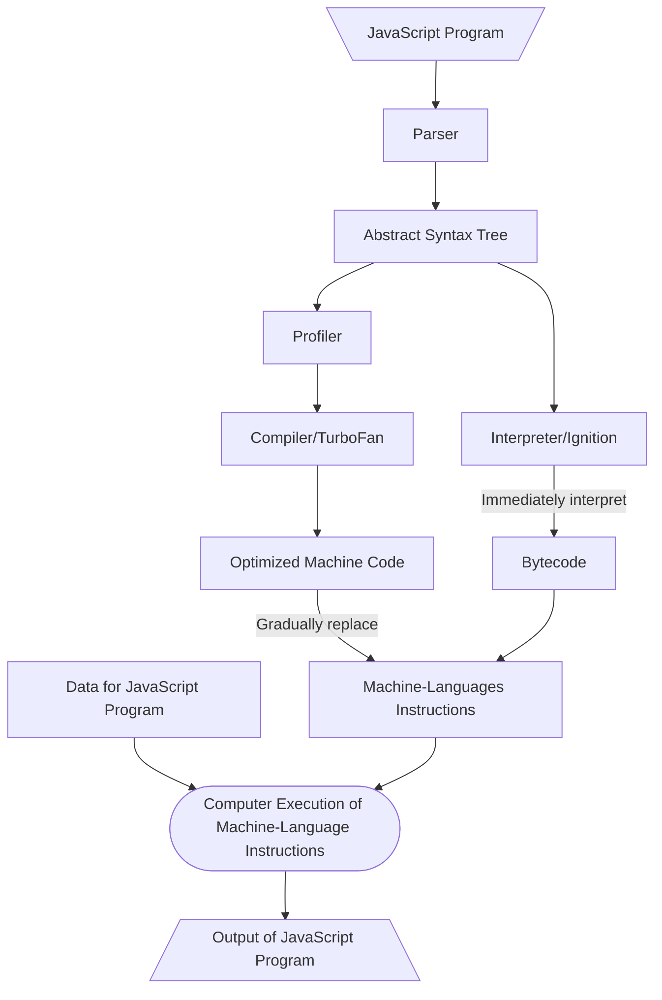
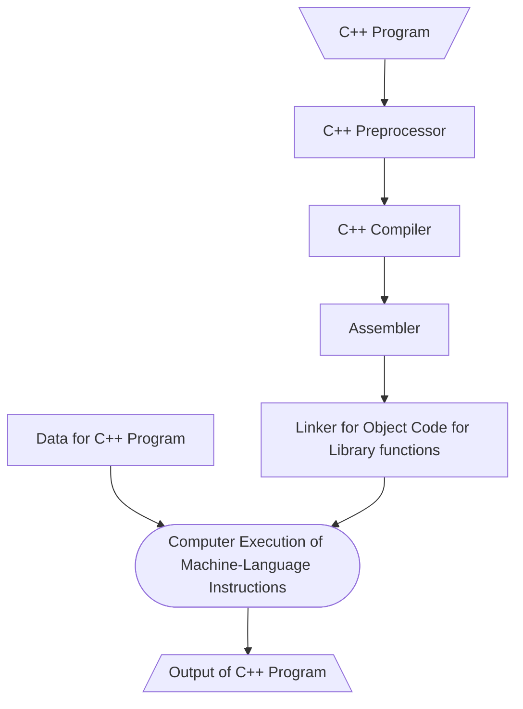
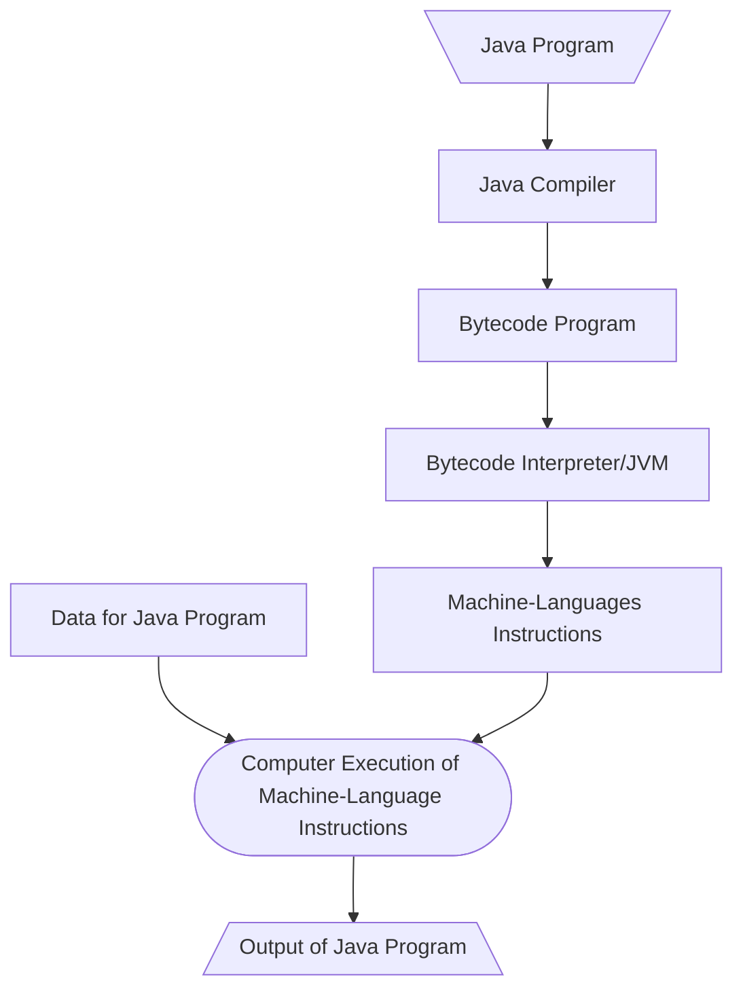

# Language Comparison

The difference between programming languages.

## Type

Category of programming languages. A language is static/dynamic means when the information is acquired, if the code is interpreted immediately then it is dynamic, vice versa. A strong typed programming language means it rarely or not allow automatic implicit type conversion while a weak typed one allows implicit type conversion easily.

| Language   | Static | Dynamic | Strong | Weak | Special Note                   |
| ---------- | ------ | ------- | ------ | ---- | ------------------------------ |
| JavaScript |        | Yes     |        | Yes  |                                |
| TypeScript | Yes    |         | Yes    |      | The output is JavaScript code. |
| C++        | Yes    |         |        | Yes  |                                |
| Java       | Yes    |         | Yes    |      |                                |
| Python     |        | Yes     | Yes    |      |                                |

## Compilation

The following is the difference of the executing flow for different programming languages.

### JavaScript

JavaScript program is compiled **Just-In-Time**, which means it doesn't need to be compiled beforehand. In order to execute JavaScript programs, we need to use a JavaScript engine which is already embedded in every modern browser. There are engines like V8 for Chrome, Nitro for Safari, and SpiderMonkey for Mozilla, however, only V8 is used for JavaScript to execute without a browser due to modules such as `fs` and `Net` rely on the V8 interface between **C++** and **JavaScript**, which is called **Node.js**.

Since JavaScript and Node.js are both written in C/C++, technologies such as ASM.js and WASM is available to run C/C++ in JavaScript/Node.js.

### C++

C++ programs are CPU-specified. Use `clang++ simple.cpp -o simple.out` to compile code in `simple.cpp` to a machine-language file `simple.out`. Since `simple.out` is a machine-language file, the outcome for using `./simple.out` to execute may be not supported or crashed if the user's CPU is different from the machine compiled the program.

### Java

Use `javac Simple.java` to compile Java program into bytecode, which is not platform specified, so we can send/use it through internet. This is called **portability**. Then use `java Simple` to use the Java Virtual Machine, **JVM**, to compile the bytecode into machine-language only as needed and execute it (Just-In-Time). Compiled code will be stored for next use.

