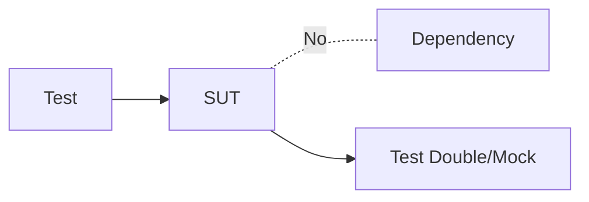
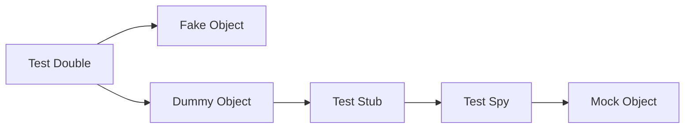

# Test Double

當測試一 SUT 時，通常會有許多 DOC。例如我們有個驗證使用者資訊的 SUT，可以預期會有 DOC 如加密帳號密碼、介面 UI、輸入的基本驗證等。而我們需要專注在單一功能，否則會導致必須設想的情況過多、無法做出有價值的測試，這時就得排除其他 DOC 產生的變數，也就是使用 Test Double 來代替 DOC 們：

- **Test Stub**: 一個 **樁**，回傳固定內容。建立一個 Control Point 來對 SUT 進行 Indirect Input
- **Test Spy**: 與 **Test Stub** 相似，但能紀錄、驗證呼叫該 Spy 的次數與對象等資料。通常跟著模擬對象 (DOC) 的介面與邏輯
- **Mock Object**: 具有斷言 Assertions 的 **Test Stub**。作為一個 Observation Point 使用，能夠在 **測試中** 驗證 SUT 的 Indirect Output
- **Fake Object**: 一個假的、簡單許多的 DOC。不能用作 Control Point 或 Observation Point。會使用的理由通常是真實 DOC 尚未準備好或在測試環境使用會導致測試時間過長
- **Dummy Object**: 填充 SUT 測試中需要的物件 (有些 SUT 要求物件作為 Parameter)，單純只為了讓程式可以運行



:::info 提醒
在很多場合與文件會用 **Mock** 來稱呼 Test Double，或者像 Jest 一樣直接使用 `jest.mock` 命名。
:::

### Others

一些其他常見的名詞：

- **Test Fixture**: 又稱 **Test Context**，為了測試準備的資料。可以稱為假資料、預期輸入與輸出。注意與 Test Double 不同、層級並非代替 DOC
- **Indirect Input**: SUT 數值的變動並非來自在測試中直接輸入，而是某個 DOC
- **Indirect Output**: SUT 的狀態改變後，無法藉由直接的 API 去取得新的狀態，但該 SUT 同時也會影響到其他元件，這些其他元件受影響的狀態就是 Indirect Output
- **Interaction Point**: 指 SUT 在測試中互動的點，可指 **Control Point** 或 **Observation Point**
- **Control Point**: 操作 SUT 的介面。有些 Control Point 是為了測試而存在，必須注意在 Live 環境是否移除
- **Observation Point**: 測試中檢核 **過去** 運作的 SUT 狀態的介面，不可在 Live 環境中存在以免曝露資訊

## Jest

以 Jest 示例 Test Double：

### Test Stub

假設有個 `obtainBestUser`、用作取目前 `score` 最高的使用者，我們想要測試是否每次都會取出正確的使用者：

```typescript title="index.ts"
interface IUser {
  name: string;
  identity: number;
  score: number;
}

export function obtainBestUser(
  obtainListOfUser: () => Promise<IUser[]>
): IUser {
  const listOfUser = await obtainListOfUser();
  return listOfUser.sort((previous, next) => previous.score - next.score)[0];
}
```

我們使用 `jest.fn` 建立一個 Test Stub、輸出二組 User，藉此固定除了 `obtainBestUser` 外的變數：

```typescript title="index.test.ts"
import { obtainBestUser } from "./index";

const mockedObtainListOfUser = jest.fn();

describe("obtainBestUser", () => {
  it("Does the output user have the highest score", () => {
    mockedObtainListOfUser.mockReturnValueOnce(
      new Promise<IUser[]>((resolve) =>
        resolve([
          { name: "ken.zhang", identity: 101, score: 5 },
          { name: "bill.chen", identity: 102, score: 10 },
        ])
      )
    );
    expect.assertions(1);
    return expect(obtainBestUser(mockedObtainListOfUser)).resolves.toEqual({
      name: "bill.chen",
      identity: 102,
      score: 10,
    });
  });
});
```

### Test Spy

可參考 [Redux](/docs/practice/redux) 和 [Scope](/docs/practice/scope)。以下我們有個 `storeHighestScore`，能將 Redux Store 內的當前 User Profile 存入 LocalStorage：

```typescript title="index.ts"
import { store } from "state";

export function setLocalProfile() {
  const profile = store.getState().status.profile;
  localStorage.setItem("profile", JSON.stringify(profile));
}
```

接著使用 `jest.spyOn` 模擬 `store` 的介面與邏輯，並以 `toHaveBeenCalled` 驗證 `store.getState` 的使用：

```typescript title="index.test.ts"
import { store } from "state";
import { setLocalProfile } from "./index";
import { handleUser } from "source";

describe("setLocalProfile", () => {
  it("Does the function store profile correctly", () => {
    jest.spyOn(store, "getState");
    store.getState = jest.fn().mockReturnValue({
      status: { profile: handleUser.default },
    });
    setLocalProfile();
    expect(store.getState).toHaveBeenCalled();
    expect(localStorage.getItem("profile")).toBe(
      JSON.stringify(handleUser.default)
    );
  });
});
```

### Mock Object

我們有個依賴 `lodash` 的 Function：

```typescript title="index.ts"
import * as _ from "lodash";

export function handleChunk(listOfInput: any[]) {
  return _.chunk(listOfInput);
}

export function handleCompact(listOfInput: any[]) {
  return _.compact(listOfInput);
}
```

而在測試時，我們利用 `mock` 將 Lodash 的 `chunk` 表現固定，並在同時 **保持** 其他 Lodash 的邏輯與功能：

```typescript title="index.test.ts"
import * as _ from "lodash";

import { handleChunk, handleCompact } from "./index";

jest.mock("lodash", () => {
  return {
    ...jest.requireActual<{}>("lodash"),
    chunk: (listOfInput: any[], size: number) => {
      return [[listOfInput.slice(0, 2), listOfInput.slice(2, 4)]];
    },
  };
});

describe("handleCompact", () => {
  it("Does the function work correctly", () => {
    const listOfInput = [0, 1, 2, 3];
    const listOfChunk = handleChunk(listOfInput, 2);
    /** 以下已被 Jest 固定，必為 2 組 Array */
    expect(listOfChunk).toEqual([
      [0, 1],
      [2, 3],
    ]);
    expect(handleCompact(listOfChunk[0])).toEqual([1]);
  });
});
```

### Fake Object

假設我們撰寫了一個使用者相關的 Function：

```typescript title="index.ts"
import handleUser from "./handleUser";
export async function obtainMale() {
  const listOfUser = await handleUser.fetchWithGender("male");
  return listOfUser;
}
```

而實際上這邊的 `handleUser` 還尚未開工、只有大概定義的介面：

```typescript title="handleUser.ts"
export default function handleUser() {
  return {
    fetchWithGender: async function (gender: "male" | "female") {
      return;
    },
  };
}
```

那麼可以用 `mock` 將整個 `handleUser` 替換為一個 Fake Object：

```typescript title="index.test.ts"
import handleUser from "./handleUser";
import { obtainMale } from "./index";

jest.mock("./handleUser", () => {
  return {
    fetchWithGender: async function (gender: "male" | "female") {
      return [
        { identity: "001", gender: "male" },
        { identity: "002", gender: "male" },
      ];
    },
  };
});

it("Does the function work correctly", () => {
  expect(obtainMale()).resolves.toEqual([
    { identity: "001", gender: "male" },
    { identity: "002", gender: "male" },
  ]);
});
```

### Dummy Object

若我們在購物車有個驗證功能如下：

```typescript title="index.ts"
function validateProductWithUser(product: Product, user: User) {
  /** 進行驗證，回傳 Boolean */
}

export function validation(product: Product, user: User) {
  const isValid = validateProductWithUser(product, user);
  return isValid;
}
```

那麼在實際測試中，可以為 Product 和 User 實作一個 Dummy Object，以排除依賴：

```typescript title="index.test.ts"
import { validation } from "./index";
import Product from "./Product";
import User from "./User";

const dummyProduct = class DummyProduct extends Product {};
const dummyUser = class DummyUser extends User {};

it("Does the function work correctly", () => {
  expect(validation(dummyProduct, dummyUser)).toBe(true);
});
```

## When to Use

只有真實 DOC 以下其中之一成立時，使用 Test Double 才有價值：

- 行為與表現不可預期
- 難以設置或觸動
- 執行過慢、導致測試時間過長
- 是 UI
- 使用到 Callback
- 尚不存在
- 當該 DOC 與 SUT 是跨系統的關係 (如 SMTP 與 LogIn UI)

節省測試成本，應以高層級的 Test Double 為優先使用，例如在能用 Test Stub 時就不該用 Test Spy：



## When to Share

由於共享本身會造成 Dependencies、且 Test Case 間的行為的差異無可預期，Test Double 在測試檔案間應獨立存在，除了以下情況：

- 是能夠被實作 Dependency 的 Fake Object
- 是能夠設置的 Test Stub，能夠根據 Test Case 控制不同表現
- 是無行為的 Dummy Object
