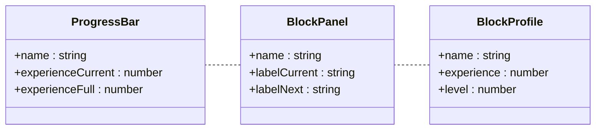
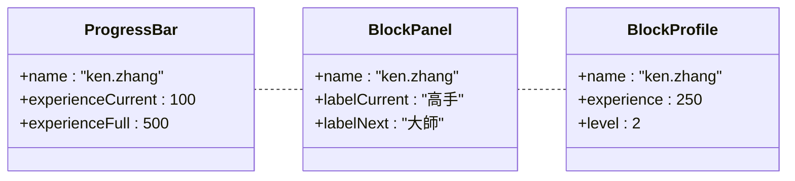
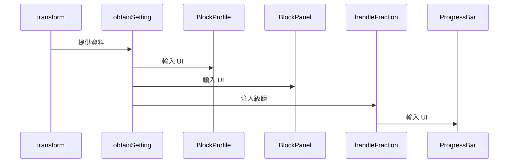

# Advantages

實務上，Unit Test 可以帶來的具體效益有：

- [符合需求](/docs/unit-test/advantages#符合需求): 以通過測試為優先進行設計，保證符合最低可用性
- [核心檢查](/docs/unit-test/advantages#核心檢查): 自動化檢查核心功能，特別是頁面之間資料有覆用、前端需做各類計算時
- [保證良率](/docs/unit-test/advantages#保證良率): 無法對整個流程或體驗做出保證，但可以通過提高單一元件的良率優化整體品質
- [重構指標](/docs/unit-test/advantages#重構指標): 高覆用性與低耦合是 Unit Test 與物件導向優劣的指標

:::caution 注意
測試的品質與程式碼品值沒有絕對正比關係。一個專案良好設計了 Test Cases 並且覆蓋率達 100%，只代表良好地實踐了物件導向設計。
:::

## Scenario

以下以實際情境舉例。假設我們有個 RPG，玩家有以下基本資料：

```typescript
interface IUser {
  identity: number;
  name: string;
  experience: number;
}
```

而在使用者畫面中，我們有 3 個 Component 會分別顯示當前資訊與經驗值：



並且有以下級距表。每個等級有當前 Label 以及下個 Label，`nextLevelRequiredExperience` 是要達到下個級距的需求 `experience`：

```typescript
interface ILevelSetting {
    labelCurrent: string;
    labelNext: string;
    nextLevelRequiredExperience: number;
}

const listOfLevelSetting: ILevelSetting[] = [
  {
    labelCurrent: "學徒";
    labelNext: "高手";
    nextLevelRequiredExperience: 50;
  },
  {
    labelCurrent: "高手";
    labelNext: "大師";
    nextLevelRequiredExperience: 100;
  },
  {
    labelCurrent: "大師";
    labelNext: "菁英";
    nextLevelRequiredExperience: 500;
  }
];
```

## 符合需求

在開發之前，我們可以先行分析每個 Unit 的需求與功能，並且規劃 Test Cases，以通過測試為優先進行設計，保證符合最低可用性。首先代入實際數值：



根據以上，可以設想以下情況：

- 每個級距的達到條件是 `experience` >= 之前級距 `nextLevelRequiredExperience` 的總和，也就是要達到第 5 個級距 `experience` 是 >= 前 4 個的 `nextLevelRequiredExperience` 總和
- 第一個級距 `experience` 到達需求為 0
- `experience` 為 0 時套用的 `labelCurrent` 是 **學徒**，100 時則為 **高手**
- 達到 **高手** 的需求 `experience` 是 50，而達到 **大師** 則是 150
- 在 **高手** 級距且 `experience` 為 250 時，**ProgressBar** 內的 `experienceCurrent` 應為 100，而 `experienceFull` 應為 500
- **BlockProfile** 中若 `labelCurrent` 為 **學徒**，則 `level` 應為 1

接著以達成以上情境 (相關測試) 為目標構想，可以更容易設計出覆用性高和符合需求的程式。實務中，這個階段也必須和 UI 設計師、PM 核對內容，避免理解有誤。

## 核心檢查

進入開發時，首先注意測試的優先目標是自動化檢查核心功能，特別是頁面之間資料有覆用、前端需做各類計算時。在這邊 **BlockPanel** 與 **ProgressBar** 共用一組資料，也就是當下 `experience` 對應的級距。根據以上，我們可以規劃 3 個核心 Function 來實現需求：

- **transform**: 整理來源的 `listOfLevelSetting`，提供易用資料
- **obtainSetting**: 透過 `experience` 取得當下級距
- **handleFraction**: 透過 `experience` 取得當下經驗比例



#### 處理級距表

為了方便取用每個級距的資料，首先計算出每個級距的需要經驗 `currentLevelRequiredExperience` 與等級 `level`：

```typescript
interface ILevelSettingFused {
  labelCurrent: string;
  labelNext: string;
  nextLevelRequiredExperience: number;
  currentLevelRequiredExperience: number;
  level: number;
}

function transform(listOfLevelSetting: ILevelSetting[]) {
  return listOfLevelSetting.reduce<ILevelSettingFused[]>((accumulator, currentValue, currentIndex, array) => {
    currentLevelRequiredExperience =
      currentIndex === 0 ? 0 : currentLevelRequiredExperience + array[currentIndex - 1].nextLevelRequiredExperience;
    accumulator.push({
      ...currentValue,
      currentLevelRequiredExperience,
      level: currentIndex + 1,
    });
    return accumulator;
  }, []);
}
```

#### 取得當前級距

3 個 Component 都必須對應當下級距來顯示對應資料，這邊傳入 `experience` 與 `listOfLevelSetting` 來取得：

```typescript
function obtainSetting(experience: number, listOfLevelSetting: ILevelSettingFused[]) {
  let currentLevelSetting: ILevelSettingFused = {
    labelCurrent: '',
    labelNext: '',
    nextLevelRequiredExperience: 0,
    currentLevelRequiredExperience: 0,
    level: 0,
  };
  listOfLevelSetting.some((item, index, array) => {
    if (
      (experience >= item.currentLevelRequiredExperience && experience < array[index + 1]?.currentLevelRequiredExperience) ||
      !array[index + 1]
    ) {
      currentLevelSetting = item;
      return true;
    }
    return false;
  });

  return currentLevelSetting;
}
```

#### 取得經驗比例

**ProgressBar** 中需要顯示 `experienceCurrent` 與 `experienceFull` 作為分母與分子，如 `50/125`。這邊傳入當下級距來取出需要的值：

```typescript
function handleFraction(experience: number, currentLevelSetting: ILevelSettingFused) {
  const { currentLevelRequiredExperience, nextLevelRequiredExperience } = currentLevelSetting;
  const numerator = Math.min(experience - currentLevelRequiredExperience, nextLevelRequiredExperience),
    denominator = nextLevelRequiredExperience;

  return { numerator, denominator };
}
```

## 保證良率

規劃好如何處理資料後，我們可以針對 `transform`、`obtainSetting` 與 `handleFraction` 設計 Test Cases，並在一個階段後 (Push hook/Merge request) 進行測試，保證預期輸出正確：

- **transform**:
  - 最大 `level` 與 `listOfLevelSetting` 長度一致
  - `level` 為 1 的級距的 `currentLevelRequiredExperience` 為 0
  - 每個級距的 `currentLevelRequiredExperience` 是前面級距 (不包含自己) 的 `nextLevelRequiredExperience` 的總和
  - 最大 `level` 的 `currentLevelRequiredExperience` 在所有級距中為最大
  - ...
- **obtainSetting**:
  - 輸入的 `listOfLevelSetting` 不為空陣列的情況，輸出 `currentLevelSetting` 欄位不應有 `""` 或 0
  - 迴圈比對不同 `experience` 對上固定 `listOfLevelSetting` 的輸出是否符合預期
  - ...
- **handleFraction**:
  - 是否輸出的 `numerator` <= 輸入的 `experience` 且不小於 0
  - 只有 `experience` 為 0、`level` 為 1 的情況 `numerator` 與 `experience` 會相等
  - `numerator` <= `denominator`
  - ...

在確保程式碼運作能每次通過以上測試時，已經達成了 Unit Test 大致的目標。雖然我們沒有在 UI 上看見最終結果、甚至沒有傳遞資料到 DOM 上檢核，但 Unit Test 的目的正是保證單一 Unit 的運作。事實上，若是牽涉到 DOM、已經屬於 Integration Test 的範疇，會使用到 React Testing Library 一類的 Package。實務上，會將這類 Function 從 Component 中抽出，以便單獨測試。

## 重構指標

至此，我們的程式碼已經大致符合 Unit Test 的一些原則：快速輕巧、單一測試、切中核心，然而，若是實務架構沒達到呢？高覆用性與低耦合度是優秀 Unit Test 的指標，原則上，無論程式碼如何變動，只要需求不變，寫好的 Unit Test 都不需要改動，在發現引入測試時左支右絀、甚至需要改到測試檔案時，或許是時候專心重構。而真的到了那個階段，保證通過 Test 的設計會令步調快上不少。

```bash
├── 撰寫測試
├── 引入測試
│   ├── 驗證成功，繼續撰寫其他測試
# highlight-next-line
│   └── 發現高耦合，重構後回到撰寫測試
└── ...
```

:::caution 注意
無論是否需要重構，已完成並通過驗證的測試都不會再變動。
:::

前端開發中，常見檔案四散分類，已是一個明顯的模組化傾向 (雖然不能放入瀏覽器中單獨執行)。若是在引入 Unit Test 遇到困難或重構比例極高，通常是開發時的架構設計不良，常見於：

1. 設計架構時預期的專案規模與後期差異過大
2. 經常遇到開發中後期才改規格的需求，尤其是橫貫整個專案的類型
3. 通常起因於前 2 點。修復時需要同時開發新 Feature，導致不良的架構越長越大

在以上情況，可以先針對獨立於主功能外的元件撰寫 Unit Test，主功能則利用其他測試覆蓋。但非主功能即代表引入 Unit Test 的效益低落，又此已是肇因於不良的架構，在遇到難以引入 Unit Test 時，通常就代表該專案進到了需要專注重構的階段。

#### 勇敢喊出我要重構吧！
