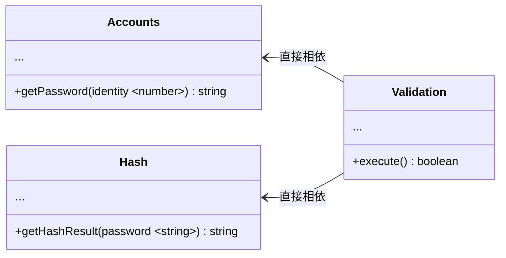
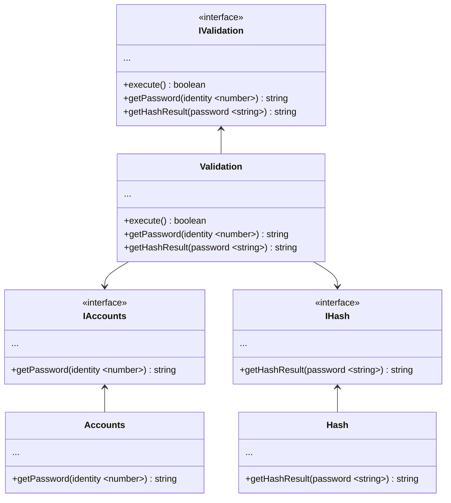
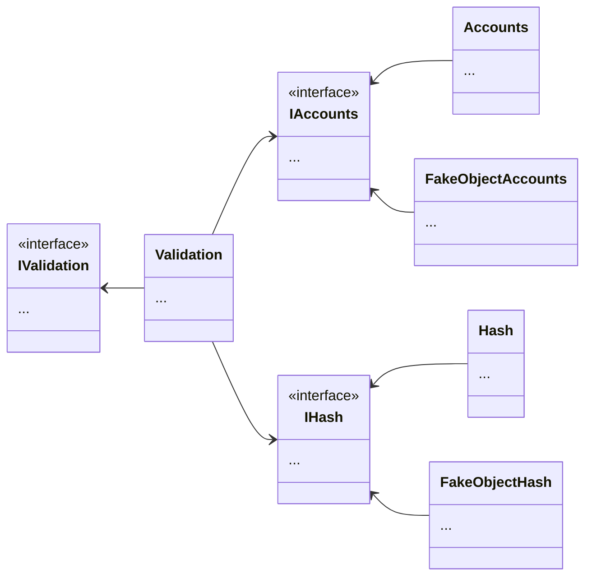

# Principles

比起 End-to-End Test、Integration Test 等，Unit Test 專注在避免可拆分的主功能錯誤。而前端常見的，需要瀏覽器渲染或支援 (與 UI 耦合)、或者牽涉到視覺效果的部分，已經屬於 Integration Test 的範疇，不考慮在 Unit Test 中。

## F.I.R.S.T

當撰寫 Unit Test 時，應該盡可能遵循 F.I.R.S.T 原則：

- **Fast**: 不夠快速的測試不會有開發者想跑。除此之外，Unit Test 不依賴任何外部資源如網路、資料庫等，本就應為輕巧
- **Independent**: 簡而言之，即是不會動用到受測單元外的資源，諸如網路、資料庫、其他 DOC 等
- **Repeatable**: Unit Test 應該要可以在 **任何** 環境中輸出一樣的結果。若是一個 Unit 中有 2 個以上的情境，則應將其拆分。如此一來，Unit 會變得單一、獨立，即符合 Repeatable 的原則
- **Self-validating**: 測試的結果應清晰可見。這點在使用測試框架如 Jest 都已幫我們完成，可以很容易看見失敗的測試
- **Thorough**: 與 Repeatable 相關聯。撰寫測試時應同時考慮到 Happy Path 和 Negative Scenario。若是遵循 TDD 原則的開發者，則會是 **Timely**，即要即時撰寫測試

:::info 提醒
**TDD**，Test-driven development，簡單而言，是在實作之前先寫測試，確保專案符合驗收規格。**BDD**，Behavior-driven development，則是 TDD 的延伸，除了先寫測試外，還會產出一份以自然語言撰寫的規格書，讓非技術人員能夠參與討論、減少與工程師間的溝通成本，在測試中也可以看到故事性更強。
:::

## Others

一些同樣應該盡可能遵循的原則：

- **單位**: 單元測試中，最小的單元不是 Component，而是 Function、Method、Class。引入 Unit Test 到現有專案時，最首要做的就是將可預期輸入輸出、可獨立於 UI 之外的 Unit 單獨抽出
- **單一**: 一個測試案例，應只測試一個情境
- **無邏輯**: 測試單元內不會有商業邏輯、故事性。在 Unit Test 中，最重要、也只做的事，就是保證各個單元的預期運作
- **預期情境**: Unit Test 無法對無可預期的情境做測試，只有設想了輸入與輸出的情況才可實作
- **不依賴外部**: 不會動用到受測單元外的資源，諸如網路、資料庫、其他 DOC 等
- **無耦合**: 又稱 **隔離相依性**。遇到不同功能在同一單元時，應果斷拆分、讓單元只接受介面，而不是直接放入其他單元

### 直接相依

假設現在有一個驗證的服務，要針對使用者輸入的 `Identity` 與 `password` 進行驗證。商業邏輯如下：

- 根據 `identity`，取得存在資料來源中的密碼（僅存放經過 Hash 後的結果）
- 根據傳入的密碼，進行 Hash
- 比對資料來源回傳的密碼與輸入密碼經過 Hash 的結果

```tsx title="accounts.ts"
const Accounts = class Accounts {
  public getPassword(identity: string) {
    /** 比對 `identity` 由資料來源取出 Hash 過的 `password` */
  }
};
export default Accounts;
```

```tsx title="hash.ts"
const Hash = class Hash {
  public getHashResult(password: string) {
    /** Hash 輸入的 `password` 並回傳 */
  }
};
export default Hash;
```

```tsx title="index.ts"
import Accounts from './accounts';
import Hash from './hash';

const Validation = class Validation {
  public execute(identity: string, password: string) {
    const accounts = new Accounts();
    const passwordStored = accounts.getPassword(identity);

    const hash = new Hash();
    const passwordHashed = hash.getHashResult(password);

    return passwordStored == passwordHashed;
  }
};
export default Validation;
```

其實 `validate` 是取得 `password`、取得 Hash 結果、比對是否相同，三個步驟而已。但在物件導向的設計中必須要滿足單一職責原則，將不同的職責，交由不同的物件負責，再透過物件之間的互動來滿足使用者需求。`execute` 其實根本就不管、也不在乎 Accounts 以及 Hash 物件，因為那不在它的商業邏輯中，但卻為了取得 `passwordStored` 而直接初始化 AccountDao 物件，為了取得 `password` Hash 結果而直接初始化 Hash 物件。

所以，`validation` 便與 Accounts 以及 Hash 直接相依。其類別關係如下圖所示：



### 介面相依

直接相依除了在測試時違背 **隔離相依性** 原則外，也容易在修改時違背 **OCP**，Open Close Principle，開放封閉原則。例如將 Accounts 的資料來源由資料庫改為 CSV、或是將 Hash 的規則與輸入替換，以上兩者更改勢必需要直接改動 `Validation`，這樣代表物件間的耦合性過高，當需求異動時，無法輕易的擴充和抽換。

為了隔離相依性，我們應該將物件僅相依於介面上：

```tsx title="accounts.ts"
export interface IAccounts {
  getPassword: (identity: string) => string;
}

const Accounts = class Accounts implements IAccounts {
  public getPassword(identity: string) {
    /** 比對 `identity` 由資料來源取出 Hash 過的 `password` */
  }
};
export default Accounts;
```

```tsx title="hash.ts"
export interface IHash {
  getHashResult: (password: string) => string;
}

const Hash = class Hash implements IHash {
  public getHashResult(password: string) {
    /** Hash 輸入的 `password` 並回傳 */
  }
};
export default Hash;
```

```tsx title="index.ts"
import { IAccounts } from './accounts';
import { IHash } from './hash';

interface IValidation {
  getPassword: IAccounts['getPassword'];
  getHashResult: IHash['getHashResult'];
  execute: (identity: string, password: string) => boolean;
}

const Validation = class Validation implements IValidation {
  getPassword: IAccounts['getPassword'] = () => '';
  getHashResult: IHash['getHashResult'] = () => '';
  constructor(getPassword: IAccounts['getPassword'], getHashResult: IHash['getHashResult']) {
    this.getPassword = getPassword;
    this.getHashResult = getHashResult;
  }

  public execute(identity: string, password: string) {
    const passwordStored = this.getPassword(identity);
    const passwordHashed = this.getHashResult(password);

    return passwordStored == passwordHashed;
  }
};
export default Validation;
```

類別相依關係如圖所示：



### 遵循 Ioc 測試

如此一來，`Validation` 就能專注於自身的商業邏輯，而不相依任何實體物件。這種讓目標初始化後再傳入的方法，稱為 IoC，Inversion of Control，控制反轉 (物件導向的一種設計原則，用於減少耦合)，具體來說，這邊是用 DI，Dependency Injection 來實現 Ioc。

由以上範例，我們可以實現以下測試：

```tsx title="__mocks__/accounts.ts"
export const stubGetPassword = jest.fn();
const fakeObjectAccounts = jest.fn().mockImplementation(() => {
  return {
    getPassword: stubGetPassword,
  };
});
export default fakeObjectAccounts;
```

```tsx title="__mocks__/hash.ts"
export const stubGetHashResult = jest.fn();
const fakeObjectHash = jest.fn().mockImplementation(() => {
  return {
    getHashResult: stubGetHashResult,
  };
});
export default fakeObjectHash;
```

```tsx title="index.test.ts"
import Validation from './index';
import Accounts, { stubGetPassword } from './accounts';
import Hash, { stubGetHashResult } from './hash';

jest.mock('./accounts');
jest.mock('./hash');

it('Does validation work correctly', () => {
  stubGetPassword.mockReturnValue('1001');
  stubGetHashResult.mockReturnValue('1001');
  const accounts = new Accounts();
  const hash = new Hash();
  const validation = new Validation(accounts.getPassword, hash.getHashResult);
  expect(validation.execute('username', 'password')).toBe(true);
});
```

上方測試的概念如圖所示：


