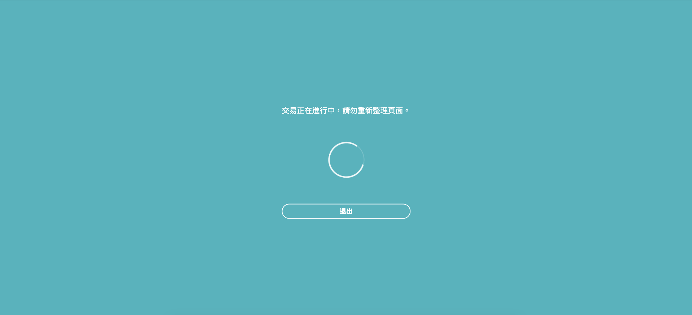

# AJAX and SetInterval

## Overall

This is needed when you want to use AJAX once every seconds as long as you reach the condition. Basically AJAX doesn't allow you to just set a time to expect it repeats happening again and again, It only happens **once** if you only set a simple function.

Here I combine this need with [Process Loading,](progress-loading.md) the main idea is to place this AJAX to a SetInterval function, then trigger it once the interval reaches. The time will be reset after the interval.



## JavaScript

```javascript
var transaction_url = "/payment/get/transaction/no/" + response.sum_id;
var timeOutId = 0;
$.blockUI({
  baseZ: 210000,
  css: {
    border: 'none',
    padding: '36px',
    color: '#fff',
    lineHeight: 1.45,
    fontSize: '18px',
    borderRadius: '0px',
    background: 'transparent',
  },
  message: $('#newebpay-dialog'),
});
clearProgressDuringPayment();

function renderProgressDuringPayment(progress) {
  progress = Math.floor(progress);

  if (progress < 25) {
    var angle = -90 + (progress / 100) * 360;
    $(".animate-0-25-b").css("transform", "rotate(" + angle + "deg)");
  } else if (progress >= 25 && progress < 50) {
    var angle = -90 + ((progress - 25) / 100) * 360;
    $(".animate-0-25-b").css("transform", "rotate(0deg)");
    $(".animate-25-50-b").css("transform", "rotate(" + angle + "deg)");
  } else if (progress >= 50 && progress < 75) {
    var angle = -90 + ((progress - 50) / 100) * 360;
    $(".animate-25-50-b, .animate-0-25-b").css("transform", "rotate(0deg)");
    $(".animate-50-75-b").css("transform", "rotate(" + angle + "deg)");
  } else if (progress >= 75 && progress <= 100) {
    var angle = -90 + ((progress - 75) / 100) * 360;
    $(".animate-50-75-b, .animate-25-50-b, .animate-0-25-b").css("transform", "rotate(0deg)");
    $(".animate-75-100-b").css("transform", "rotate(" + angle + "deg)");
  }
  if (progress == 100) {}
}

function clearProgressDuringPayment() {
  $(".animate-75-100-b, .animate-50-75-b, .animate-25-50-b, .animate-0-25-b").css("transform", "rotate(90deg)");
}

var i = 0;
var times = 0;
var interval = setInterval(function () {
  i++;
  times += 1;
  if (times >= 100) {
    i = 1;
    times = 1;
    clearProgressDuringPayment();
  }
  renderProgressDuringPayment(i);
}, 60);
if (typeof (transactionResponse.data) != 'object') {
  var ajaxFn = function () {
    $.ajax({
      url: transaction_url,
      type: 'GET',
      async: false,
      error: function () {
        console.log('Error');
      },
      success: function (response) {
        console.log('Success');
        if (typeof (response.data) == 'object') {
          clearTimeout(timeOutId);
          transactionResponse.data = {};
          transactionResponse.data.transactionId = response.data.transactionId;
          transactionResponse.code = 0; // to suit afterBooking function since code api has changed
          $.unblockUI();
          afterBookingTWD(transactionResponse);
          resetForm();
        } else {
          timeOutId = setTimeout(ajaxFn, 8000);
        }
      },
      complete: function () {
        console.log('Complete');
      }
    });
  };
  ajaxFn();
  timeOutId = setTimeout(ajaxFn, 20000);
};
```


The original source is [Here](https://stackoverflow.com/questions/9350746/using-settimeout-with-ajax-calls). [Here](https://stackoverflow.com/questions/37041346/endless-loop-with-setinterval) is another example.


## HTML

```markup
<div id="newebpay-dialog" style="display:none; cursor: default">
  <div class="newebpay-dialog-container">
    <p></p>
    <div class="loader">
      <div class="loader-bg">
      </div>
      <div class="spiner-holder-one animate-0-25-a">
        <div class="spiner-holder-two animate-0-25-b">
          <div class="loader-spiner"></div>
        </div>
      </div>
      <div class="spiner-holder-one animate-25-50-a">
        <div class="spiner-holder-two animate-25-50-b">
          <div class="loader-spiner"></div>
        </div>
      </div>
      <div class="spiner-holder-one animate-50-75-a">
        <div class="spiner-holder-two animate-50-75-b">
          <div class="loader-spiner"></div>
        </div>
      </div>
      <div class="spiner-holder-one animate-75-100-a">
        <div class="spiner-holder-two animate-75-100-b">
          <div class="loader-spiner"></div>
        </div>
      </div>
    </div>
    <input type="button" id="newebpay-dialog-exit" value="{{ translation.exit_value }}" />
  </div>
</div>
```

## SCSS

```css
#newebpay-dialog {
  position: fixed;
  top: 50%;
  left: 50%;
  transform: translate(-50%, -50%);
  background: #56b2bd;
  width: 100%;
  height: 100%;
  font-family: 'Roboto', 'Noto Sans TC', sans-serif !important;

  .newebpay-dialog-container {
    position: fixed;
    top: 50%;
    left: 50%;
    transform: translate(-50%, -50%);

    .loader {
      margin: 72px auto 0;
      position: relative;
      width: 100px;
      height: 100px;
      transform: rotate(0deg);
      animation-name: spining;
      animation-duration: 6s;
      animation-iteration-count: infinite;
      animation-timing-function: ease-in-out;

      @keyframes spining {
        0% {
          transform: rotate(0deg);
        }

        50% {
          transform: rotate(360deg);
        }

        100% {
          transform: rotate(0deg);
        }
      }
    }

    p {
      font-size: 21px;
    }

    #newebpay-dialog-exit {
      margin-top: 72px;
      border: 2px solid white;
      // background: #362428;
      background: transparent;
      border-radius: 108px;
      width: 100%;
      padding: 6px 12px;
      color: white;
      transition: .15s;
      font-size: 18px;
      font-weight: 900;

      &:hover {
        cursor: pointer;
        background: white;
        color: #56b2bd;
      }
    }
  }
}
```

