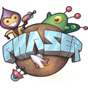

# Phaser 3

## Overview

Phaser is a fast, free, and fun open source HTML5 game framework that offers WebGL and Canvas rendering across desktop and mobile web browsers. Games can be compiled to iOS, Android and native apps by using 3rd party tools. You can use JavaScript or TypeScript for development.

