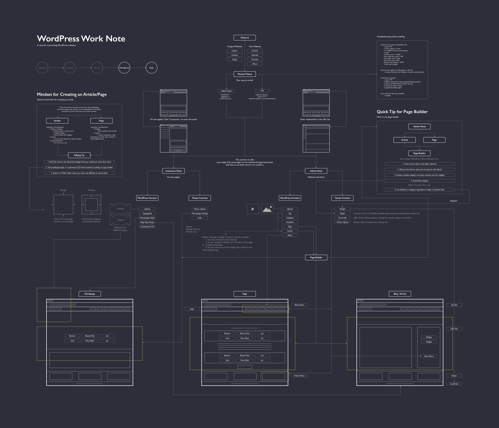

# WordPress

## Overview

WordPress is a free and open-source content management system \(CMS\) based on PHP & MySQL. Features include a plugin architecture and a template system. It is most associated with blogging but supports other types of web content including more traditional mailing lists and forums, media galleries, and online stores. Used by more than 60 million websites, including 33.6% of the top 10 million websites as of April 2019, WordPress is the most popular website management system in use.

## Marketing Work Process

A reference work flow based on my experience in the first month.

