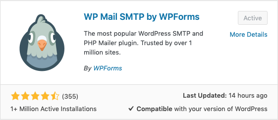

# Contact Form

## Form Sender Issue

After transferring host or relocate URL, it is very common to have this issue that sender's email doesn't match with the domain, it will cause the auto mail sending unsuccessfully, to fix it, we should go through the steps.

1. Install SMTP plugin **WP Mail SMTP by WPForms**
2. Ask the domain host for any further information
3. SMTP plugin setup

## Sender’s Message Failed to Send

When a user completes a form, the info is not successfully sent to where it should go, instead of that the form shows an error code called _**Sender’s message failed to send**_ from **Contact Form 7**. The info would still pass through server even when the form shows an error code, so it is possible to collect the info by plugins **Flamingo** which collect form info pass by the server.

#### Lazy Way to Fix

1. Modify the error code message
2. Install Flamingo to collect form info in Back-End

But we are not sending any email if we go this way, this is not recommended.

#### Correct Way to Fix

1. Get the deeper error code which is able to reflect the situation
2. Solve the problem by setting up the right configure

### Solution

Usually if Contact Form 7 configure setting is set properly, it should work fine in WordPress. The major reason for _**Sender's message failed to send**_ is because of that WordPress is using mail\(\) method in server. Most Web Hosting Service is actually supporting this kind of method, however, if there is any circumstance that users are not able to send info by forms, we have to go SMTP setup.

#### Install WP Mail SMTP by WPForms


If you are not able to overwrite any file or upload any theme to your WordPress Site via FTP, please ask your host to grant you authentication **777**.


#### Set up SMTP configure

Get the SMTP host name, port, and recommended encryption from different SMTP Host, and apply your account.


Solution from this [Article](https://progressbar.tw/posts/60) and this [Article](https://progressbar.tw/posts/63).


