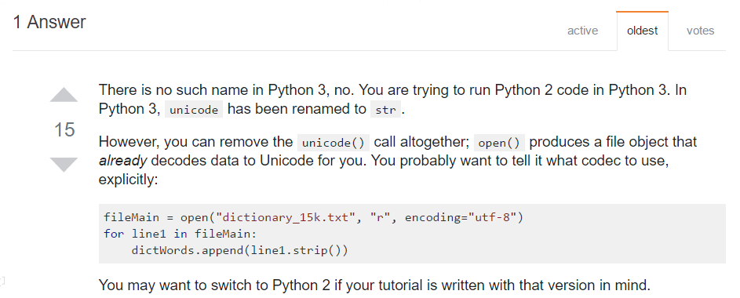

# Trouble Shooting

## Trouble Shooting

Common issues.

### TypeError: string indices must be integers

The variable `item` is a string. An index looks like this. The example uses the `0` index of the string to refer to the first character.

```python
>>> mystring = 'helloworld'
>>> print mystring[0]
'h'
```

Strings can't have string indices \( Like dictionaries can \). So this won't work.

```python
>>> mystring = 'helloworld'
>>> print mystring['stringindex']
TypeError: string indices must be integers
```


The original [Discussion](https://stackoverflow.com/questions/6077675/why-am-i-seeing-typeerror-string-indices-must-be-integers).


### TypeError: Object of type Template is not JSON serializable

`simplejson` and `json` don't work with Django objects well.

Django's built-in [serializers](https://docs.djangoproject.com/en/dev/topics/serialization/) can only serialize query-sets filled with Django objects:

```python
data = serializers.serialize('json', self.get_queryset())
return HttpResponse(data, content_type="application/json")
```

In your case, `self.get_queryset()` contains a mix of django objects and dicts inside.

One option is to get rid of model instances in the `self.get_queryset()` and replace them with dicts using `model_to_dict`:

```python
from django.forms.models import model_to_dict

data = self.get_queryset()

for item in data:
   item['product'] = model_to_dict(item['product'])

return HttpResponse(json.simplejson.dumps(data), mimetype="application/json")
```

But the easiest way is to use **JsonResponse**.

```python
from django.http import JsonResponse
queryset = YourModel.objects.filter(some__filter="some value").values()
return JsonResponse({"models_to_return": list(queryset)})
```


The original [Discussion](https://stackoverflow.com/questions/16790375/django-object-is-not-json-serializable).


### TypeError: unsupported operand type\(s\) for +: int and str

In Python, `+` refers a **Math** calculation or a **String** combination, when is kind error happens, which means you are trying to `+` strings and numbers, which confuses Python, It doesn't know whether you are going to do a calculation or a combination.

This is wrong.

```python
pprint(1 + "1")
```

These two are right.

```python
pprint(int(1) + int(1))
>>> 2
```

```python
pprint(str(1) + str(1))
>>> 11
```

### ValueError: invalid literal for int\(\) with base 10

The following are totally acceptable in python.

* passing a string representation of an integer into int
* passing a string representation of a float into float
* passing a string representation of an integer into float
* passing a float into int
* passing an integer into float

But you get a `ValueError` if you pass a string representation of a **float** into `int`, or a **string** representation of anything but an integer \( including **empty string** \). So here is a list that you can't use `int` on.

* float
* string
* empty string


You can use **type\(\)** to know whether its type is.


If you do want to pass a string representation of a float to an `int` ,you can convert to a float first, then to an integer.

```python
>>> int('5')
5
>>> float('5.0')
5.0
>>> float('5')
5.0
>>> int(5.0)
5
>>> float(5)
5.0
>>> int('5.0')
Traceback (most recent call last):
  File "<stdin>", line 1, in <module>
ValueError: invalid literal for int() with base 10: '5.0'
>>> int(float('5.0'))
5
```

### Python http.client.RemoteDisconnected

There is nothing you can do, checkout with your BackEnd Team or MIS.

### Undefind Name unicode

See the answer from StackOverFlow. This is caused by the difference between **Python2** and **Python3**.



### Str object has no attribute decode

Which means you are trying to decode an object that is **already** _decoded_. You have a `str`, there is no need to decode from UTF-8 anymore.

Simply drop the `.decode('utf-8')` part.


